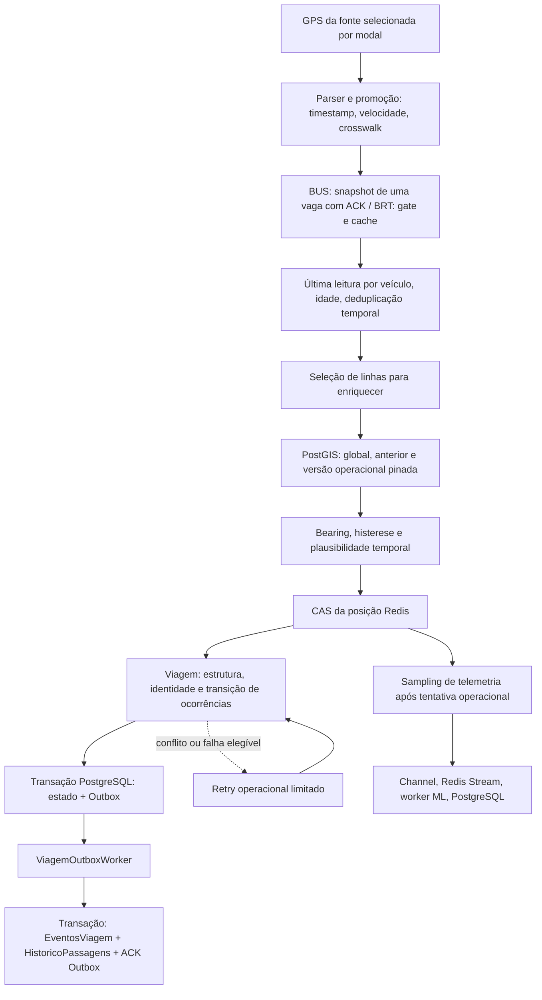

# Auditoria da geração de passagens após GPS/GTFS-RT

Data: 11/10/2026. Escopo: inspeção local de código, Git e documentação; sem correções funcionais.

## 1. Decisão e limites da evidência

**Ainda não há evidência suficiente para liberar o primeiro treino real pós-migração. Podemos avançar com inventário exploratório e auditoria de uma cópia local, mas o exportador atual não aceita honestamente o perfil da nova release.** Não é necessário aumentar tolerâncias, reativar ETA ou atingir o volume antigo para iniciar essa investigação.

Há três impedimentos separados:

1. **Operação:** a perda de cobertura ainda não foi localizada no funil. Os números fornecidos não distinguem GPS não promovido, matching ausente, identidade operacional bloqueada ou menor oferta de transporte. Não há regressão produtiva comprovada nesta auditoria.
2. **Procedência:** `tools/EtaMl.Export/Program.cs:14–30` exige literalmente commit/imagem/sampling da coleta oficial de 07/10. Uma janela GTFS-RT precisa de perfil prospectivo explicitamente revisado em etapa posterior; preencher o manifesto com a imagem antiga para passar o gate falsearia a procedência.
3. **Qualidade/volume:** `AuditadaSemProtecao` exige evidência externa da execução inteira; os agregados fornecidos e o estado corrente não a provam. O treino real também exige mínimos de volume temporal e viagens completas, ainda não medidos em dados elegíveis.

Distinções usadas no relatório:

- **Comprovado no código/Git:** comportamento reproduzível por leitura das fontes locais, sem afirmar que esses bytes estão em produção.
- **Informado pelo operador/documentação histórica:** contagens, flags, imagens implantadas, saúde da telemetria e resultados anteriores de testes. Não verificados remotamente agora.
- **Hipótese:** mecanismo possível com condição de confirmação explícita.
- **Lacuna:** informação não disponível, não substituída por inferência.

HEAD local: `6f64538b47cb3987c5bf023d9878931b69228dac`. Base imediatamente anterior aos commits GTFS-RT: `70d7bcb8041e167df063237b4fdcafd4971b01d6`. Não houve fetch. Preservadas alterações locais preexistentes em `FormaPagamento.cs`, `HISTORICO.md` e documentação de schedules. Este relatório e seu roteiro SQL são documentação da auditoria; só foi acrescentada uma entrada ao histórico.

Fontes consultadas: `AGENTS.md`, entradas pertinentes do histórico, [release local03](../releases/GTFSRT_LOCAL03_20261009.md), [migração](../../NoPonto/docs/GPS_GTFSRT_MIGRACAO.md), [canário](../../NoPonto/docs/GPS_GTFSRT_CANARIO.md), [matching](../03-funcionalidades/03-matching-v2-e-viagem-operacional.md), [telemetria](../03-funcionalidades/15-telemetria-historico-e-ground-truth.md), [contrato 3A](../../NoPonto/docs/ETA_ML_DATASET_3A.md), [coleta limpa](../../NoPonto/docs/ETA_ML_COLETA_LIMPA_3A_2.md) e [pipeline 3B](../../NoPonto/docs/ETA_ML_TREINO_3B.md). Documentos de migração/canário descrevem fases anteriores; suas condições de ativação não são prova do estado atual. O resumo local03 e o código posterior prevalecem quando diferem.

### Distribuição fornecida

| Janela UTC de 2026 | Dia | Eventos de passagem | Histórico | Linhas |
|---|---|---:|---:|---:|
| 08/10 23:45–23:55 | Quinta | 3082 | 3096 | 178 |
| 09/10 23:45–23:55 | Sexta | 98 | 98 | 13 |
| 10/10 23:45–23:55 | Sábado | 38 | 37 | 7 |
| 11/10 15:00–15:10 | Domingo | 24 | 24 | 2 |

Quinta → sexta: cerca de **96,8% menos eventos e 92,7% menos linhas com passagem**. São linhas com eventos, não necessariamente linhas reconhecidas pelo matching. Quinta/sexta têm mesmo horário local (20:45–20:55), mas dias diferentes. Domingo é 12:00–12:10 local e não serve como continuação quantitativa da mesma comparação.

A proximidade journal/histórico sugere investigar primeiro os estágios anteriores à materialização, **sem excluir Outbox**: eventos não materializados podem faltar nas duas tabelas. Os +14 históricos na quinta e −1 no sábado precisam de comparação por identidade e relógio. Não conhecemos os SQLs originais, seus filtros/modal ou se usaram `TimestampEvento`, `TimestampPassagem`, `TimestampGps` ou `TimestampRegistro`. Essas escolhas mudam a contagem, especialmente com interpolação/retry. Journal não tem coluna de instante de inserção; `TimestampEvento` é tempo semântico.

## 2. Arquitetura efetiva do fluxo atual



**Posição aceita não equivale a viagem atualizada, e telemetria persistida não equivale a label disponível.** O CAS pode aceitar GPS sem matching; a factory pode produzir telemetria sem `ViagemId`, `Volta` ou próxima ocorrência operacional. Os ~278 mil registros e a persistência ML saudável não medem esse estágio do funil.

### Gates, rejeições e observabilidade

| Etapa | Condições e descarte | Observabilidade e limites | Diferença recente |
|---|---|---|---|
| Fonte/parse | GTFS-RT 2.0/FULL_DATASET; veículo, route, posição e VP.timestamp presentes; coordenadas válidas; GPS até idade configurada e no máximo 120s no futuro. Header não fabrica timestamp GPS. Envelope duplicado/delete/header inválido pode rejeitar o feed inteiro; observação inválida é descartada. | `failure`, `parser_rejected`, `duplicates`. Motivos individuais do parser não são integralmente separados. | Parser novo; timestamps Unix-segundos, em vez dos formatos legados. |
| Promoção GTFS-RT | `ROUTE_ID` único em DATARIO_GTFS; linha/código válidos; agência/origem coerentes; direction presente deve constar no crosswalk. Velocidade finita convertida pela unidade explícita e em [0,90]. Alias BRT colidente é excluído. | `raw`, `promoted`, `unresolved_route`, `invalid_direction`, `invalid_speed`. `raw` já passou por parser/freshness, não é o total original de envelopes. Alias colidente não tem contador dedicado; promoted cai sem razão própria. Cache normalizado reutilizado retorna antes desse log. | Legado copiava código da fonte; BUS legado convertia velocidade não parseável para 0. Novo filtro pode legitimamente reduzir volume, mas seu impacto real é desconhecido. |
| Handoff/aquisição | BUS GTFS usa uma vaga; geração pendente impede nova aquisição, sem janela/watermark/catch-up. BRT preserva gate e reutiliza último sucesso, inclusive após vazio/falha. | `BUS current snapshot`, `Coleta GPS`, `snapshot_sppo_pendente`, cache/idade/status. Métricas de watermark do coletor legado não descrevem o ramo snapshot. `brt_consultas_http` mede chamada ao gate/fonte, que pode reutilizar cache do cliente GTFS sem HTTP externo real. | BUS perde possibilidade de recuperar janela histórica da fonte antiga. Snapshot não guarda posições intermediárias. |
| Normalização/freshness | Mantém só GPS mais recente por `Ordem` em cada ciclo; rejeita idade > `MaxIdadeGpsSegundos` (default 300). | `entrada`, `input`, `age_rejected`, `validas`; input do diagnóstico é posterior ao agrupamento por veículo. Sem denominador de todos os veículos descartados antes da promoção. | Agrupamento e idade já existiam. Novas fontes podem fornecer outros ritmos/identidades. |
| Dedupe | GPS deve ser maior que ativo Redis; sem ativo utilizável, compara watermark `veiculo:{ordem}:ts`. Falha/valor inválido no fallback aborta o ciclo. Não usa recente como predecessor. | `timestamp_ignored`, leituras iniciais Redis, erro de ciclo. Não há contagem individual de cada motivo de ativo inutilizável. | `26eb318`: filtro passa a ocorrer antes de enriquecer/ETA/CAS também quando ativo expirou. |
| Seleção de enriquecimento | `GpsPolling.EnriquecerTodasLinhas=true` ou linha com assinante SignalR. Caso contrário aceita GPS com histórico de velocidade, sem enriquecimento nem passagem. | `requested`, `enriquecimento_solicitado`, `sem enriq.` e log inicial `enriquecerTodas`. | Gate preexistente, default **false**. Override ausente após deploy pode explicar cobertura concentrada; estado efetivo não fornecido. |
| Matching PostGIS | Código exato; versões atuais de padrões da linha para global; geometria utilizável; distância default 250m e diferença angular <80°. Bearing: deslocamento físico ≥10m, senão fonte, senão memória confirmada; sem bearing não faz global. | `accepted`, `missing_bearing`, `missing_line`, `no_candidate`, `no_directed_candidate`, `infrastructure_unavailable`, `previous_pattern_invalid`. Nulo legado global é `global_null_unresolved`, não ausência comprovada. | Nenhuma mudança de tolerância ou do SQL matching em `70d7bcb..HEAD`; mudou a entrada. direction/trip externos ficam como hints/diagnóstico; não forçam padrão/sentido no matching. |
| Continuidade/plausibilidade | Histerese de troca (30m ou 100m conforme situação), faixa anterior e versão operacional pinada. Orçamento default `(90×2/3,6)×Δt+50m`; timestamp crescente, avanço/regressão/wrap plausíveis. Cache do enriquecedor expira após 3 ciclos sem rota. | `candidate_rejected`, `timestamp_non_monotonic`, `forward_jump`, `linear_backward_excess`, `circular_progress_incompatible`, `geometry_invalid`. Salto físico pode aparecer como falta de bearing, com warning específico. | Diagnóstico novo não muda regra. Memória é atualizada antes do CAS; commit não confirmado pode deixar referência à frente. |
| CAS posição | Somente Accepted avança para operação/telemetria/broadcast. RejectedOlderOrEqual e InfrastructureFailure são separados. Bootstrap/guard Redis continuam necessários. | `commits_tentados/aceitos/rejeitados/infra` e warnings. Matching aceito é anterior a esse gate. | Writer CAS/TTLs não mudaram no hotfix de timestamp. |
| Identidade/ocorrências | Matching atual, estrutura compatível, transição ordenada válida, versão/cursor/volta consistentes. Nova execução incorpora baseline sem emitir passagens anteriores. Circular ambígua preserva proteção e não gera labels. Viagem pinada pode não avançar mesmo com matching observacional válido. | `viagem_*`, divergência, conflito, infraestrutura, logs de viagem criada/proteção/recuperação; nem todo retorno sem avanço tem warning individual. | Regras principais entraram em 07/10; não foram redesenhadas na migração. Confirmar `MudancaOperacionalHabilitada` efetivo. |
| Evento/transação | Emite somente ocorrências cruzadas; ID `passagem:viagem:ocorrencia:volta`. Estado e Outbox juntos sob lock por veículo/versionamento. Falha de viagem não desfaz GPS aceito. | Contadores de catch-up, transações/PG, falhas operacionais/retry. Eventos são duráveis na Outbox antes do journal/histórico. | Reuso de prova estrutural no `551b734`, não nova regra de passagem. |
| Materialização | Valida payload/estrutura; journal e histórico idempotentes na mesma transação. ACK Outbox no mesmo commit do batch. Conflito de payload/estrutura falha e faz retry; falha batch isola itens. | `outbox_batch_claimed/processed/failures`, inserts journal/histórico, pendentes/tentativas. Zero inserts pode ser replay idempotente. | Worker/materializador não mudaram no intervalo da migração. |

Referências de código: `GpsPollingService.cs:178,244,288,330,427,1105`; `GtfsRealtimeGps.cs:47,137`; `GtfsRealtimeGpsSource.cs:74`; `GtfsRealtimeRouteLookup.cs:11`; `GpsEnriquecimentoService.cs:100,558,664`; `GpsItinerarioRepository.CombinedSetBased.cs:23`; `OcorrenciaParadaRepository.cs:12`; `ViagemOperacionalRepository.cs:107,198,287,412`; `ViagemOutboxWorker.cs:88,123`; `HistoricoEventoRepository.cs:46`. Paths sob `NoPonto/2-Application/Services/GPS`, `NoPonto/4-Data/Repositories` e `NoPonto/2-Application/Services/BackgroundServices` conforme nome.

### Retry e perdas que a saúde ML não cobre

`RetryOperacionalGps.cs:9,77,136` é recuperação de melhor esforço Redis acionada pelo polling, não ingresso histórico durável. Defaults: TTL 180s, 4 tentativas, 3 itens/veículo, 2000 globais, 4 tentativas/ciclo, timeout 3s, lease 60s. Não cobre todo matching sem candidato: é registrado principalmente para conflito/falha operacional, infraestrutura de matching identificável ou observação aguardando backlog anterior.

Precisa predecessor físico consistente com histórico do DTO, intervalo ≤180s e sem salto implausível; descarta expiradas, superadas por estado durável/quente, contexto alterado/perdido e rejeições operacionais. Pode bloquear avanço operacional posterior enquanto mapa GPS segue. **Retry não republica telemetria ML nem corrige a identidade da observação já persistida.** Os diagnósticos agregados de matching são `origin=polling` e não incluem retry. Falhas ambíguas do global legado podem não ser classificadas como infraestrutura e, portanto, não entrar na recuperação.

`ViagemOutboxWorker` é o caminho registrado em `Program.cs:610`. O `HistoricoPassagemWorker` Redis legado existe no código, mas não está registrado ali; o stream de viagem é espelho bounded para diagnóstico/compatibilidade, não autoridade atual. Outbox usa lease 2min, batch até100 e backoff exponencial até300s; não tem o limite de cinco tentativas/DLQ do worker ML/consumer Redis legado. A ausência de DLQ ML não comprova saúde da Outbox operacional.

## 3. Mudanças entre 07/10 e 10/10

Datas abaixo são do Git no fuso −03:00, não horários de implantação.

| Commit/data | Mudança e possível efeito |
|---|---|
| `3e40d92`, 07/10 10:57 | Checkpoint: mudança operacional protegida por flag, integridade circular, retry, associação confiável da telemetria e contrato offline. Pode suprimir labels ambíguos/retroativos e finalizar logicamente viagens ao confirmar outra operação. **Já está na base pré-GTFS `70d7bcb`**. Se a imagem da quinta era anterior, isso é outra comparação, ainda sem prova. |
| `749b882`, 07/10 13:27 | Pipeline/exportador offline; não registrado no polling como treino. Não causa queda de passagens. |
| `70d7bcb`, 07/10 17:49 | Corrige baseline no renascimento após Finalizada para posição atual; evita cursor antigo absorver alvos iniciais. Tem testes de renascimento/cursor/labels. Não autoriza recuperação retroativa. |
| `5417b70`, 08/10 17:28 | Fontes GTFS opt-in, parser/promoção/crosswalk; BUS snapshot em lugar de janela quando selecionado. Principais gates novos anteriores ao matching. |
| `50f5fc1`, 08/10 17:28 | Documentação/gates de validação, sem mudança operacional por si só. |
| `9f6b71c`, 08/10 18:35 | Origem/agência/direction do crosswalk e validação integrada; restringe promoção a identidades homologadas. Metadados faltantes/conflitantes podem excluir linhas inteiras. |
| `551b734`, 08/10 20:12 | Reutiliza prova estrutural por observação e mede etapas. No diff atual, estrutura previamente lida é reutilizada no ramo equivalente; projeção operacional mantém ramo próprio. Menos consultas, não redução intencional de candidatos. |
| `66f2e26`, 09/10 15:55 | Consolida working tree da local03: gate ETA OFF, descanso de5s após excesso de cadência, métricas matching. Descanso pode reduzir frequência sob sobrecarga; instrumentação não muda condições de matching. |
| `cf488ba`, `2c5323e`, 09/10 15:55 | Build/config/documentação da release. Seleção real depende do ambiente/overlay, não só assembly. |
| `26eb318`, 09/10 16:37 | Watermark temporal Redis sem ativo válido evita repetir GPS antes do matching. Pode reduzir processamento inútil; CAS já rejeitava timestamps antigos/iguais. Não há prova de que passagens anteriores fossem duplicadas por esse mecanismo. Falha de leitura fallback interrompe ciclo e é investigável por logs. |
| CI/startup/deploy em 09/10 | Alteram validação/publicação/política de startup/deploy; podem mudar imagem/configuração efetivas, mas não o algoritmo GPS→passagem. Confirmar runtime manualmente. Não auditada infraestrutura em execução. |
| Tarifas `9abe89f`, 09/10 22:34 | Outro domínio; não encontrada mudança em geração de passagens nessa entrega. |
| `ff2fc3f`, 10/10 00:12 (merge `6f64538`) | Separa modal BRT em importadores/listagem. Lookup GPS atual valida modal pelo metadado externo de agência/origem, não por `Linhas.Modal` isoladamente. Commit não reclassifica automaticamente dados produtivos existentes. Importação posterior pode mudar estrutura; execução real não comprovada. |

Comparação estática `git diff 70d7bcb HEAD` nos componentes centrais:

- `ViagemOperacional.cs`, `.Mudanca.cs`, `.Integridade.cs`, `OcorrenciaParadaRepository`, SQL PostGIS de matching, retry, telemetria/factory, sampling, Outbox worker e materializador: **sem delta**.
- `GpsEnriquecimentoService`: muda a classificação de geometria inválida; batch passa a agregar diagnósticos após WhenAll. Sem tolerância relaxada/endurecida.
- `ViagemOperacionalRepository`: guarda/reutiliza prova estrutural e acrescenta contador; não altera condições de cruzamento.
- Polling: diagnósticos, descanso GTFS e dedupe watermark. Aquisição/crosswalk são os maiores deltas semânticos.

### O que podemos comparar como versões

`docs/releases/GTFSRT_LOCAL03_20261009.md:5–9` informa imagem local03 `sha256:adebd1705ed8f216b8598de219daa94d5905b84e74f11a6ad0b444b91e9ea942`, construída de **551b734 com working tree**, consolidada depois. Logo, data do commit de consolidação não é data de introdução do comportamento em produção. O histórico também registra build-102 e outros releases como informações do operador, sem resolver qual imagem atende cada janela.

`70d7bcb` é base de código pré-migração, não identificação comprovada da imagem em 08/10 23:45Z. A coleta oficial 3B referencia `3e40d92`/imagem `sha256:2bbb601108bfe9c7d0f7723da3bc3b2f1c696868e7dfe88f087b345d733eb0eb`; tampouco prova que essa imagem atendia aquela janela. São necessárias identidade do container/imagem, intervalos de uptime/deploy e flags efetivas por período. Não atribuir causalidade pelo timestamp Git.

## 4. Flags ETA/ML e dependências indiretas

| Ambiente → configuração | Efeito comprovado | Relação com operação |
|---|---|---|
| `ML__ETA__Enabled` → `ML:ETA:Enabled` | `GpsEtaOptions` captura no startup; ausência=true; valor inválido falha na leitura. `GpsEtaClient.cs:37` OFF retorna vazio antes de enumerar/preparar/HTTP/cooldown. | Polling chama depois do matching e segue para CAS/viagem. ETA vazio não gateia passagens. Pode alterar custo/cadência do ciclo por remover HTTP, não a elegibilidade geométrica. |
| `EtaV2__Enabled` → `EtaV2:Enabled` | Gate de previsão shadow e manutenção. | Não controla matching, viagem, Outbox ou ingress ML. |
| `EtaV2__ShadowEnabled` → `EtaV2:ShadowEnabled` | Shadow requer **ambas** true e candidato operacional elegível (`EtaV2Shadow.cs:133`). | Chamada após atualização operacional, sem substituir identidade/label. |
| `TelemetriaMlSampling__Enabled` → `TelemetriaMlSampling:Enabled` | Seleciona identidade modal/linha por bloco UTC usando hash/seed; disabled coleta tudo, não desliga ML. 10% não é seleção independente de10% de veículos/passagens. | Chamada depois da tentativa de atualizar viagem (`GpsPollingService.cs:1153`). Não amostra geração de eventos operacionais. Quantidades de histórico não devem cair90% apenas por essa flag. |

**Ressalva indireta real:** `HistoricoEventoRepository.cs:129` chama `IEtaV2Repository.ClosePassageAsync` dentro da transação histórica mesmo com ETA flags OFF; a implementação (`EtaV2Repository.cs:75`) não consulta essas flags. Assim, falha/custo dessa atualização auxiliar pode atrasar materialização em conjunto com journal/histórico, inclusive sem nova previsão. Não há evidência de que ocorreu. OFF não desregistra o repository nem elimina esse SQL; a consulta pontual de pendentes/logs separa essa hipótese. Isso não muda matching nem confirmação geométrica, mas impede afirmar isolamento absoluto de persistência.

`GpsPolling.HistoricoHabilitado` existe no modelo de opções, porém não foi encontrado consumo como gate do caminho durável atual. **`EnriquecerTodasLinhas` e `MudancaOperacionalHabilitada` são flags operacionais distintas das quatro flags solicitadas** e precisam constar na validação efetiva. Não assumir seus valores pelo estado de ETA.

## 5. Finalizações tardias

### Regras comprovadas

- Sem estado anterior, matching/estrutura/transição válidos criam `ViagemIniciada` no GPS atual. Baseline incorpora ocorrências atrás da posição, sem passagens retroativas.
- Linear: cruzar ou permanecer com cursor terminal e sem próxima ocorrência leva a `PossivelFim`; duas confirmações posteriores com `permaneceTerminal` finalizam no timestamp GPS da segunda. A condição usa cursor/ausência de próximas e cruzamentos, **não prova por si só presença física no centro do terminal**. Não há prazo máximo entre essas confirmações na regra (`ViagemOperacional.cs:165–188`).
- Nova execução após `Finalizada` exige sentido inequívoco, duas evidências compatíveis dentro de180s e deslocamento físico **e** progresso ≥10m. Seu início é a confirmação atual, não o primeiro candidato; baseline próprio evita labels retroativos.
- Com `MudancaOperacionalHabilitada`, viagem Ativa/PossivelFim pode ser encerrada ao confirmar nova linha/sentido. As duas evidências da **nova operação** precisam estar em180s; isso não limita a idade da viagem antiga ou o intervalo desde sua última passagem. Evento antigo de fim e novo início compartilham timestamp da confirmação, e fim tem ocorrência nula (`ViagemOperacional.Mudanca.cs:22–32`). Não existe `MotivoFim` explícito nesse ramo.
- Recuperação de circular ambígua também pode fechar antiga e iniciar nova no instante atual; aqui há `motivo_fim=PerdaContinuidadeCircular` (`ViagemOperacional.Integridade.cs:160`). Circular confiável não tem encerramento terminal equivalente ao linear.
- Sem matching atual, `ViagemObservadaService.cs:54` retorna sem atualização. GPS ausente, fonte vazia/falha ou TTL do ativo expirado não finalizam viagem. Estado PostgreSQL é durável; TTL24h da projeção Redis não é timeout da viagem. Não foi encontrado finalizador por inatividade no fluxo registrado.
- Com flag de mudança OFF, ou evidência insuficiente/ambígua, mudança de linha/versão pode manter a execução anterior sem passagens. Diferença apenas de padrão/topologia dentro da mesma linha/sentido não confirma automaticamente outra execução nem mesmo com flag ON.

### Interpretação dos casos >1h e >11h

**Intervalos longos são possíveis pelas regras atuais. Não comprovam, isoladamente, erro de timestamp ou chegada atrasada.** Uma execução pode ficar aberta sem GPS/matching, permanecer em PossivelFim sem confirmações, ou aguardar reconhecimento de outra operação. Em particular, fim lógico pode representar reconhecimento tardio da fronteira, não instante físico de chegada. A regra de mudança já existe no checkpoint de07/10; não nasceu necessariamente no GTFS-RT.

Também é possível que um período longo esconda perda de cobertura operacional. Classificar os casos exige `motivo_fim`, ocorrência terminal, fim/início coincidentes do mesmo veículo, sequência de passagens e telemetria/matching/logs no intervalo. A consulta Q4 fornece evidências pontuais. Ocorrência nula + início simultâneo é compatível com fechamento lógico; **não certifica sozinha** o ramo executado. Evento sem motivo é lacuna, não permissão para inventá-lo.

Para ETA, label continua `TimestampPassagem − TimestampGps da observação`, e não `Fim − GPS`. Um fim tardio não invalida automaticamente cada trecho anterior com label curto, identidade e continuidade comprovadas. Entretanto, a qualidade da execução completa e os splits continuam obrigatórios no contrato atual. Viagem aberta, protegida, cruzando split ou sem evidência suficiente deve ficar fora do export elegível. Não substituir início/fim pelo primeiro/último GPS, não dividir a viagem em novas fronteiras de treinamento para contornar o gate e não usar ausência de GPS amostrado como prova de ausência física.

## 6. Hipóteses priorizadas e como distingui-las

| Prioridade | Hipótese | Evidência e condição de confirmação |
|---|---|---|
| 1 | Restrição de promoção/crosswalk ou mudança de cobertura dos feeds (C/B) | Gates novos comprovados. local03 informa312 rotas BUS reconciliadas/38 pendentes e32 BRT; não é inventário atual. Confirmar raw→promoted e razões por modal, linhas presentes, unidade de velocidade, direções e estrutura das linhas perdidas. As38 ausentes, sozinhas, não explicam automaticamente178→13: populações não são equivalentes e falta pareamento. |
| 1 | Enriquecimento limitado a assinantes por override ausente (B/configuração) | Default false e ramo sem matching comprovados; concentração em poucas linhas é compatível. Confirmar flag efetiva e `requested/novas`, `sem enriq.` nas mesmas janelas. Configuração fornecida não inclui essa flag. Não é regressão de código demonstrada. |
| 2 | Snapshot/cadência/cache/overload reduzem observações úteis (C/B) | BUS sem catch-up, duas cadências e pausa de5s sob excesso comprovados; TTL ativo default40s pode expirar entre observações. Confirmar timestamps distintos, gaps por veículo, latências, cache/304, snapshot pendente e ciclo completo. Menor frequência não implica queda proporcional de passagens: o cruzamento pode recuperar múltiplas ocorrências. |
| 2 | Matching válido com operação antiga/pinada ou candidato/proteção sem avanço (B ou supressão legítima A) | Telemetria aceita pode ter estrutura mas identidade operacional nula; divergência/proteção e mudança operacional existem. Confirmar `accepted` alto, CAS aceito, `viagem_*` sem avanço, candidatos/proteção/retry e frações/versões das mesmas linhas. |
| 3 | Bearing/fração das novas fontes produzem mais rejeições (B/C) | Critérios não mudaram, mas entrada mudou. Confirmar `missing_bearing`, saltos, ausência de candidato e rejeições temporais normalizados por requested. Logs atuais não dão breakdown agregado por linha. |
| 3 | Dedupe watermark reduz retrabalho e evita referência temporal incoerente (A) | Hotfix comprovado. Deve elevar timestamp_ignored e reduzir enriquecimentos redundantes, preservando GPS realmente novo. CAS/event IDs já impediam muitos duplicados; não atribuir queda de labels a eliminação de duplicatas sem prova dos eventos antigos. |
| 4 | Outbox/materialização em atraso (D) | Sem delta no worker/materializador; saúde ML não exclui essa falha. Confirmar pendentes, tentativas, erros e pares journal/histórico por chave; considerar dependência ClosePassage ETA V2. |
| 4 | Versão antiga emitia múltiplas passagens indevidas (A) | Regra emite todas as ocorrências cruzadas; gaps>180s usam timestamp GPS atual sem interpolar e orçamento cresce comΔt. Matching instável/versão reiniciada podem requerer auditoria. Confirmar concentração de catch-up por GPS/viagem, gaps e trajetória física. Idempotência evita duplicata da mesma chave, mas não eventos semanticamente errados em novas viagens/voltas. Não há prova de falsos eventos na quinta. |
| Controle | Oferta/dia da semana e população diferentes (C legítima) | Dias/horários não equivalentes integralmente; domingo não comparável. Comparar também mesma faixa local em semanas/dias equivalentes se houver dados e a mesma fonte/release, separando BUS/BRT. Sem atribuir toda queda ao fim de semana. |

A/B/C/D não são mutuamente exclusivos. Nenhuma hipótese deve ser resolvida aumentando250m/80°, removendo proteção circular ou amostrando mais para recuperar volume.

## 7. Compatibilidade e riscos do dataset ETA/ML

**Formato compatível:** a migração preserva telemetria, schema de eventos e validador `noponto-eta-gps-v1`. Novos provedores `GTFSRT_BUS/GTFSRT_BRT` participam de `ObservacaoId`; direção/trip do feed não viram identidade de viagem interna. Mudança de provedor pode alterar hashes da mesma posição física: não misturar escritores/fontes como se procedência fosse igual.

**Elegibilidade não garantida:** `EventoTelemetriaMlFactory.IdentidadeCompativel` só associa viagem/volta/alvo operacional quando resultado Created/Updated, estado Ativa/PossivelFim confiável e identidade/timestamp/versão coincidem com a observação. Matching sobre versão observacional diferente da projeção operacional pode gerar GPS com campos estruturais e sem identidade elegível. Retry recupera a operação, mas não repara o registro ML anterior.

**Labels condicionais:** cruzamento não é sensor independente na parada. Timestamp interpolado só quando mesma versão, avanço ordenado e intervalo entre atualizações ≤180s; demais casos usam GPS corrente (`ViagemOperacional.cs:257`). Histórico não identifica explicitamente interpolação versus fallback. Catch-up pode aumentar volume com labels temporalmente menos precisos; campo TimestampRegistro não é alvo ETA. Os pares precisam journal schema2, mesma viagem/volta/versão/sentido/ocorrência/parada, próximo alvo operacional, label em(0,3600] e distância geography conferida na geometria original. Wrap circular para outra volta é excluído pelo MVP.

**Procedência insuficiente para certificação automática:** IntegridadeCircular é snapshot sobrescrito, não trilha completa temporal de proteção. Logs ausentes/nulos/sem erros, cutoff antigo ou flags OFF não bastam para `AuditadaSemProtecao`. Esses requisitos já constam no contrato3A/3B e continuam abertos para as execuções novas.

**Export exploratório:** inventário de candidatos em snapshot local identificado pode começar sem afirmar qualidade de treino. CSV elegível pelo exportador existente requer manifesto de viagens auditadas e perfil aceito. Para dados pós-GTFS, é preciso revisar explicitamente o gate de procedência em tarefa posterior; **nenhuma alteração foi feita aqui**. Dados anteriores só podem usar perfil antigo se a evidência real corresponder, e continuam sujeitos aos demais filtros. Não usar `data_kind=synthetic` para contornar os gates de dados reais.

**Treino:** `pipeline.py`/`check_volume.py` exigem≥10000 observações elegíveis,≥14 dias UTC,≥200/50/50 viagens completas TRAIN/VALIDATION/TEST e uma linha com≥30/10/10 viagens e≥8 horas de TRAIN. Viagens que cruzam cortes são purgadas integralmente; fim tardio pode aumentar essa perda sem invalidar cada label. ~278mil observações brutas desde um startup não provam esses mínimos. Representatividade por modal/linha/sentido/horário/distância e descartes precisam ser revisados antes de comparar MAE. Não fazer treino apenas com2–13 linhas silenciosamente e generalizar para a rede.

## 8. Validação controlada, somente manual

Roteiro: [09-passagens-pos-gtfsrt-20261011.sql](09-passagens-pos-gtfsrt-20261011.sql). **Não executado; revisão estática não prova sintaxe/plano/custo no schema instalado.** Cada bloco usa transação READ ONLY, timeout10s, lock timeout1s, idle timeout30s, parâmetros explícitos e consultas com limites. Não há EXPLAIN ANALYZE, escrita de dados, migração ou query global de telemetria. Executar um bloco por vez, numa sessão manual com acesso de leitura já existente. Se atingir limite, o resultado indica corte; não tratá-lo como contagem completa.

| Bloco | Pergunta | Acesso previsto no código/migrations |
|---|---|---|
| Q1 | Índices necessários existem e estão válidos? | Catálogos `pg_index`, `pg_class`, `pg_namespace`, `pg_attribute`; somente tabelas nomeadas. |
| Q2 | Linhas/eventos e materialização por mesma identidade nas janelas fornecidas | Índice journal `TimestampEvento`, lookup histórico único `(ViagemId,OcorrenciaParadaPadraoId,Volta)`. Cap20000 eventos/janela. |
| Q3 | GPS amostrado da mesma linha/fonte perde matching ou identidade? Catch-up concentrou muitas ocorrências no mesmo GPS? | Telemetria `(CodigoLinha,TimestampGps)`; histórico `(CodigoLinha,TimestampPassagem)`. Uma linha/janela por vez, cap10000. Sem inferir cobertura da fonte a partir de sampling. |
| Q4 | Viagem selecionada tem fim lógico/terminal, início simultâneo ou longo gap? | Journal PK EventId para fronteiras; histórico `(ViagemId,TimestampPassagem)`; journal `TimestampEvento` para faixa de2s junto do fim. Sem busca global por viagem em JSON. |
| Q5 | Há backlog operacional ou evento específico que não materializou? | Índice parcial Outbox pendentes `(CriadoEmUtc,EventId)`; PK para EventId específico. Top100, sem COUNT global ou scan de processados. |
| Q6 | RouteId conhecido resolve agência/origem/direction e estrutura publicada? | Fonte por Codigo; identidade externa única `(FonteEstruturalId,Tipo,ExternalId)`; PKs e índices FK/versão das tabelas estruturais. Uma rota por vez. Estado atual não reconstitui crosswalk de quinta. |

**Preflight obrigatório:** conferir Q1 e, se necessário, `EXPLAIN` simples do SELECT limitado antes de execução. Índice no código não prova instalação; seletividade/plano não garantidos. Se o plano prevê scan grande das tabelas operacionais, não executar; pedir recorte por chave/snapshot. Timeout não autoriza repetir sucessivamente consultas custosas. `enable_seqscan=off` não foi usado: forçar plano não comprova segurança. Não executar os blocos globais opcionais do roteiro3B.2 antigo só para obter um total ML; há milhões de registros históricos documentados.

### Inspeção manual de runtime e logs

Executar no host apropriado, substituindo o nome do container conhecido; comandos abaixo são apenas inspeção. Não executar Compose up/config completo, restart, import ou startup da API. Não copiar environment completo com credenciais.

```sh
api_container='NOME_REAL_DO_CONTAINER_API'
docker inspect --format '{{.Image}} {{.Config.Image}} {{.State.StartedAt}} {{.RestartCount}}' "$api_container"
# Saída filtrada em memória: imprime somente configurações não sensíveis desta auditoria.
docker inspect --format '{{range .Config.Env}}{{println .}}{{end}}' "$api_container" |
  rg '^(ML__ETA__Enabled|EtaV2__(Enabled|ShadowEnabled)|TelemetriaMlSampling__(Enabled|LinePercentage|BlockMinutes|Seed)|GpsSources__(BusPrimarySource|BrtPrimarySource)|GpsPolling__(EnriquecerTodasLinhas|MudancaOperacionalHabilitada|IntervaloSegundos|IntervaloBrtSegundos|TtlAtivoSegundos|MaxIdadeGpsSegundos)|GtfsRealtimeGps__(BusEnabled|BrtEnabled|BusSpeedUnit|BrtSpeedUnit|CrosswalkValidated|IntervalSeconds|MaxAgeSeconds))='
docker logs --timestamps --since '2026-10-09T23:45:00Z' --until '2026-10-09T23:55:00Z' "$api_container" 2>&1 |
  rg 'GTFSRT source=|BUS current snapshot|Coleta GPS:|Matching GPS:|Performance GPS:|Ciclo GPS:|Outbox batch:|outbox|Pendência|Retry operacional|não avançou|protegida|recuperada|Falha no ciclo'
```

Repetir a janela08/10 e10/10, com **containers/logs arquivados da versão correspondente**. Inspecionar container atual não demonstra flags da quinta. `StartedAt` não é instante de cutover histórico nem prova release anterior. Labels de imagem/deploy previamente disponíveis podem ajudar; não confiar em tag mutável/latest. Se `rg` não existir no host, usar filtro textual já disponível, sem instalar ferramenta. Filtrar logs antes de compartilhar; não enviar credenciais, coordenadas ou identificadores individuais desnecessários.

Coletar por janela/modal: raw/promoted/filtros de fonte; input/idade/timestamp_ignored; requested/completed/accepted; CAS aceitos; resultados `viagem_*`, conflitos/divergência/proteção/catch-up; backlog Outbox e identidade materializada. Comparar **somas de numeradores/denominadores**, não médias de percentuais por ciclo. Marcar ciclos incompletos; somatório dos11 resultados finais deve corresponder a completed, rejeições a candidate_rejected. `legacy_null_unresolved` é auxiliar já contido no resultado global, não um12º resultado. Sem requested não concluir falha geométrica. Sem logs históricos declarar lacuna.

Para série temporal comparável, usar o mesmo relógio semântico, modal e painel de linhas ativas; comparar quinta/sexta com cautela e também semanas/dias equivalentes se disponíveis. Separar períodos efetivos de release, fonte e estrutura, sem interpolar identidade de aplicação pelo Git. Telemetria a10% é amostra por linha/bloco: ausência de uma linha em Q3 pode ser sampling, não falha da fonte. Linhas perdidas devem ser selecionadas a partir do journal prévio e de inventário/logs da fonte, não apenas das linhas sobreviventes após migração.

## 9. Próximo passo objetivo e validações desta entrega

1. Operador identifica imagens/configurações e fronteiras de release das janelas.
2. Executa preflight e blocos seletivos Q2–Q6/logs; localiza o primeiro estágio cuja cobertura caiu e identifica os ramos dos fins tardios.
3. Preserva snapshot local transitivamente consistente de telemetria/journal/histórico/versões, mais evidência externa de continuidade; inventaria candidatos sem certificar automaticamente.
4. Em tarefa posterior, revisa perfil de coleta/exportação pós-GTFS, sem falsificar o marco antigo ou mudar fronteiras de execução. Uma correção operacional só deve ser proposta quando o gate responsável estiver comprovado.
5. Exporta apenas viagens auditadas compatíveis com perfil/contrato e mede elegibilidade/representatividade/volume. Treina quando qualidade e mínimos forem satisfeitos.

**Executado nesta auditoria:** leitura local das instruções, histórico e documentação, `git status/log/show/diff/rev-parse`, buscas/revisão das fontes e checagem de whitespace dos artefatos documentais. **Não executado:** testes funcionais/unitários/integração, build, SQL, EXPLAIN, export, treino, API, Docker, serviços, downloads/instalações, produção ou Git destrutivo/publicação. Testes existentes foram inspecionados (`GpsEtaClientTests`, `GpsTimestampDeduplicationTests`, `GtfsRealtimeGpsTests/IntegratedTests`, `ViagemOperacionalRegraTests`, `MudancaOperacionalRegraTests`, `IntegridadeCircularRegraTests`, `EtaDatasetTests`); resultados registrados em entregas anteriores não são testes reexecutados nesta auditoria. Nenhuma correção demanda novos testes nesta fase exclusivamente documental.

**Conclusão:** manter a coleta e flags informadas enquanto se mede o funil. Há impedimentos concretos de procedência/certificação para o treino pós-migração e uma suspeita operacional ainda não localizada. Inventário exploratório é o próximo passo seguro; quantidade de eventos, isoladamente, não justifica correção nem certificação.
