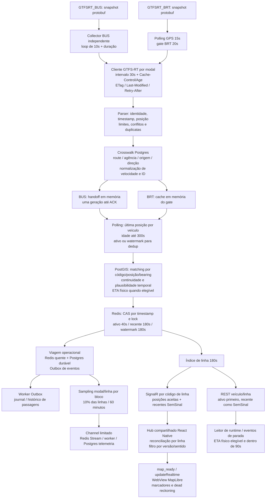

# Auditoria GPS BUS/BRT — etapa 1

19/10/2026. Somente diagnóstico: nenhuma correção funcional, mudança de configuração, implantação, migration ou ativação ETA/ML.

**Conclusão:** há perda relevante entre a disponibilidade da fonte e o uso operacional. Nesta janela, o backend recebeu novos snapshots BRT a cada **60s**, embora uma observação direta do GTFS-RT BRT encontrasse mediana de **30s** entre timestamps GPS crescentes. O predecessor físico faltou em **2.669/2.670 avaliações BRT**; a amostra Redis/REST BRT não tinha ETA. Há ainda problemas de expiração/comunicação de remoção e extrapolação no código do mapa. Não é correto atribuir os 60s somente ao provedor, nem calculá-los pela persistência amostrada.

## Escopo, procedência e limites

- Backend: `audit/gps-bus-brt-pipeline`, criado após `git fetch origin main`, diretamente de `90f7be72e4b55198bc721f4f104a58f37def3f2d`. `main` e `origin/main` coincidiam; working tree inicial limpo. Nenhum commit exclusivo da branch `chore/eta-ml-d0-d8-checkpoint` foi incorporado. Os quatro commits D0–D9 permanecem naquela branch. Nenhum push/merge/commit nesta auditoria.
- Produção: leituras SSH entre aproximadamente **22:07–22:20 UTC** (19:07–19:20 em Fortaleza); container com início em `2026-10-18T20:07:00.830482051Z`, um reinício já registrado. Imagem identificada por `sha256:db64e5200aad3faf48f55a095ca769170b650df885938d673693bc2d98b0bfb9`. Tags/labels consultadas não forneceram revisão Git. **Não foi comprovada equivalência binária dessa imagem com a main auditada.** Os fatos runtime abaixo vêm da própria imagem em execução; mecanismos internos são a leitura da main, com essa limitação de vínculo.
- Frontend: checkout irmão `noponto-frontend`, branch `ajustes`, HEAD `139859ba20784bcf99e72f80c16fb2147aff4b41`, com WIP preexistente. Foram lidos HEAD e working tree, preservados integralmente. O WIP contém `roadPresence.ts`, retenção visual e mudanças no mapa. Não há evidência nesta sessão de qual APK/build contém essas alterações ou do valor da flag pública no binário instalado.
- Evidência: código compilado/DI e consumidores; environment por whitelist e `appsettings.json` da imagem; logs limitados; GETs públicos; GET REST local; Redis `EVAL_RO` com GET/HGET/TTL e `XINFO GROUPS`; SQL somente de metadados.
- As janelas de logs se sobrepõem: **não somar** resultados dos arquivos. A leitura final do funil tem 38 ciclos completos e um incompleto excluído, com teto de 12.000 linhas. Não representa todas as horas/dias.
- Não houve captura WebSocket/SignalR real nem renderização em aparelho nesta sessão. Achados de frontend são comprovados no código; sua ocorrência num APK específico continua pendente.

## Fluxo efetivamente identificado

O handoff BUS não é fila histórica durável: só existe um lote pendente em memória e não há sobrescrita antes de ACK. Reinício perde esse estado. GTFS-RT é snapshot atual, sem recuperação dos pontos intermediários. As antigas opções de overlap/catch-up do coletor não criam histórico recuperável quando a fonte selecionada é GTFS-RT.

O mapa examinado recebe veículos pelo hub. `buscarVeiculosPorLinha` existe no serviço REST, mas não foi encontrado como hidratação dos veículos em `useMobilidadeRio`. Inscrever uma linha no hub não envia snapshot imediato; aguarda próximo broadcast elegível. Reconexão limpa inscrições conhecidas e reconcilia os consumidores; retorno ao foreground e recuperação periódica de 30s também tentam reconciliar.

## Configuração real consultada

| Item | Valor observado |
|---|---|
| Fontes primárias | `GTFSRT_BUS` / `GTFSRT_BRT` |
| Shadows configurados | `DATARIO` em ambos; configuração não comprova execução/fallback |
| Polling / gate BRT / collector BUS | 15s / 20s / 10s entre coletas BUS |
| Cliente GTFS | intervalo 30s; ambos os feeds responderam `Cache-Control: public, max-age=30` |
| TTL ativo / recente / índice de linha | 40s / 180s / 180s |
| Idade máxima GPS | 300s no polling; default GTFS também 300s |
| Matching | batch e combinado set-based ligados; enriquecimento universal ligado |
| Paralelismo enriquecimento / viagem | 4 / 4 |
| Velocidade | ambos configurados como `KilometresPerHour`; teto de promoção GTFS 90 km/h |
| Sampling histórico | ligado, 10% das identidades modal/linha, blocos de 60 min |
| ETA público físico | ligado, idade máxima 90s |
| ML legado / EtaV2 / HistoricalEtaShadow | desligados |
| PositionCorrection / seu Shadow | ligados; sampling desse Shadow 10%, distinto do sampling de telemetria |
| Checkpoint durável | 60s no appsettings da imagem; não é cadência de GPS |

Environment e appsettings foram separados nos artefatos: defaults da main não devem substituir overrides reais. `Env.NoClobber().Load()` e outras fontes de configuração existem; não foi exposto `.env` nem feito dump completo do processo. Opções ausentes da whitelist não foram promovidas automaticamente a valor efetivo confirmado. Por exemplo, a flag de mudança operacional não foi confirmada nesta sessão.

## Cinco relógios que não devem ser confundidos

| Relógio | O que mede | Cuidado |
|---|---|---|
| `VehiclePosition.timestamp` / `TimestampGps` | instante da posição física declarada | deve crescer para superar a deduplicação |
| `FeedHeader.timestamp` | geração do snapshot | não substitui o timestamp individual |
| resposta HTTP / `RecebidoEmUtc` | aquisição da fonte pelo cliente | cache/gates podem espaçar aquisições |
| início/fim do ciclo / aceite Redis | processamento e disponibilidade interna | TTL começa no aceite, não no GPS |
| criação/persistência da telemetria | observação secundária amostrada | não mede frequência integral da fonte |

No GTFS, timestamps de envio/servidor da fonte não são preenchidos como nos registros Zirix. `TimestampServidor` do DTO recebe o GPS quando não existe servidor-fonte. Isso impede tratá-lo como horário de ingestão. `RecebidoEmUtc`, modal e provedor são metadados internos ignorados na serialização do DTO Redis/HTTP; a telemetria os preserva separadamente.

Sampling seleciona **linha/modal por bloco**, sem sortear 10% de cada ponto ou cada veículo. Uma linha selecionada pode produzir todos os pontos aceitos daquele bloco; uma não selecionada pode desaparecer completamente da tabela. Além disso, a telemetria está depois de filtros, dedup, CAS e tentativa operacional, com fila/backpressure próprios. Ausência histórica pode significar seleção, descarte anterior, falha de publicação ou persistência. Não multiplicar intervalos por dez nem interpretar lacuna entre blocos como atraso do provedor.

## Comparação direta das APIs atuais e antigas

Método: nove rodadas a cada 30s; última posição por identidade por rodada; agregados sem IDs/coordenadas. Primeira janela BUS: 22:10:44–22:14:46 UTC. Complemento BRT: 22:11:23–22:15:24 UTC. Não passa por `.TelemetriasVeiculoMl`, sampling, matching ou cache da aplicação. A sondagem é independente do parser produtivo e não certifica todos os seus critérios.

| Medida direta | GTFSRT_BUS | ZIRIX | GTFSRT_BRT, complemento | BRT_RIO, complemento |
|---|---:|---:|---:|---:|
| Rodadas bem-sucedidas | 9 | 9 | 9 | 9 |
| Veículos por rodada, mediana bruta | 1.865 | 2.562 | 319 | 751 |
| Deltas GPS positivos observados | 10.946 | 20.108 | 2.349 | 4.109 |
| Delta GPS p50 / p95 | 30 / 62s | 30 / 52s | 30 / 44s | 30 / 45s |
| Idade GPS p50 | 43,140s | 19,121s | 19,396s | 17,213s |
| Idade GPS p95 | 64,077s | 35,429s | 53,364s | aproximadamente 265 mil s |
| Tempo HTTP p50 | 1,262s | 2,394s | 0,856s | 0,739s |

**Os totais brutos não são cobertura operacional comparável.** ZIRIX foi consultado por janela de 30s de `datetime_servidor`; GTFS fornece um snapshot com critérios próprios. BRT_RIO contém registros antigos e futuros mesmo após excluir linha zero: nesta leitura, extremos de aproximadamente +10.800s no futuro e 845 milhões de segundos no passado. A aplicação antiga rejeita timestamps além de +120s e o polling descarta idade superior a 300s. Não concluir que trocar de fonte recuperaria 432 BRT válidos.

Pares da mesma identidade no mesmo round:

- BUS: 15.353 pares; mediana `GPS_atual − GPS_Zirix = −30s`. Em 3.813 pares com timestamp igual, diferenças de velocidade foram zero e distância entre coordenadas teve p50 0,116m, p95 0,196m. Evidência de snapshots atuais mais antigos nessa fase da janela, não prova de GPS físico diferente.
- BRT, complemento: 2.843 pares; diferença temporal p50 zero. Em 1.559 pares com timestamp exatamente igual, diferenças de velocidade foram zero; distância p50 0,117m, p95 0,193m. Arredondamento de float do protobuf é uma explicação compatível para diferenças submétricas, sem prova da implementação do produtor.
- Outra fase de amostragem do mesmo BRT atual, na primeira janela, encontrou idade p50 40,670s e delta GPS p50 30s/p95 60s. A fase do GET em relação à geração do feed altera a idade observada. Não somar as janelas sobrepostas.
- Repetição de coordenada com timestamp crescente também ocorreu. Sem trajetória/velocidade/contexto independente, pode ser veículo parado; **não foi comprovado congelamento físico do provedor**.

A especificação [GTFS Realtime, Position](https://gtfs.org/documentation/realtime/reference/#message-position) define `speed` em m/s. Produção usa km/h e os pares com as APIs antigas tiveram igualdade numérica. Isso sustenta a configuração empírica do feed local, mas não é confirmação normativa do produtor. Não aplicar conversão 3,6 automaticamente sem confirmar o contrato real.

A primeira coleta BRT_RIO teve cinco falhas locais de decodificação gzip em nove rodadas, sem caracterizar indisponibilidade do provedor. O complemento tratou gzip com limite de corpo e completou 9/9. A falha da sonda está registrada no resumo BUS; as métricas BRT da tabela usam exclusivamente o complemento completo.

Endpoints observados: [BUS atual](https://dados.mobilidade.rio/gtfs/realtime/onibus/vehicle-positions), [BRT atual](https://dados.mobilidade.rio/gtfs/realtime/brt/vehicle-positions), [Zirix](https://dados.mobilidade.rio/sppo/zirix/gps), [BRT antigo](https://dados.mobilidade.rio/gps/brt). O script constrói a janela UTC exigida pelo Zirix.

## Evidência runtime: aquisição, pipeline e ETA

Leitura final, `gps-funnel-evidence-20261019.jsonl`, 22:18:42 UTC:

| Medida | Resultado |
|---|---:|
| Ciclos Performance GPS disponíveis | 38 |
| Start-to-start p50 / p95 | 15,000 / 15,002s |
| Duração total p50 / p95 / máxima | 1,981 / 12,783 / 14,191s |
| Entradas / válidas / novas / CAS aceitos | 64.745 / 64.744 / 31.641 / 31.641 |
| Falhas Redis de commit / matching batch / viagem | 0 / 0 / 0 nos contadores disponíveis |
| Chamadas ao gate BRT classificadas como HTTP / reutilização | 19 / 19 |
| Novos snapshots HTTP BUS: intervalos p50 / máximo | 31 / 42s, 16 intervalos |
| Novos snapshots HTTP BRT: intervalos min/p50/max | 60 / 60 / 60s, 8 intervalos |
| Linhas publicadas / veículos enviados pelo SignalR | 0 / 0 nesta janela |

**`brt_consultas_http` conta chamada ao adaptador pelo gate, não necessariamente um GET no socket.** O cliente GTFS tem outro cache e pode responder sem HTTP. Os logs `snapshot_received` identificam novas respostas/snapshots, não medem todos os GETs/304. A observação comprovada é espaçamento de snapshots novos; não foi feita captura de pacotes para contar todo tráfego HTTP.

O código do cliente agenda a próxima aquisição usando intervalo, `max-age − Age`, `no-cache`, `no-store`, `Retry-After` e validadores HTTP. O gate BRT agenda sua consulta com outro relógio, por cima dos ciclos de 15s. Exemplo compatível com o mecanismo: gate chama em t=0,30,60; cabeçalho de t=0 chega em t=0,9 e mantém cache até t=30,9; a chamada em t=30 reutiliza e a próxima oportunidade é t=60. **Essa é uma explicação forte, ainda sem replay instrumentado que isole cada relógio na imagem instalada.** O fato de 60s na aplicação contra 30s na sondagem direta já é comprovado.

Funil operacional: 38 ciclos com todas as seis partes; 31.641 avaliações novas = 28.971 BUS + 2.670 BRT = 24.948 `ItineraryChanged` + 5.537 `Updated` + 1.156 `NuloSemMatching`.

- Predecessor BUS válido: 28.422/28.971; ausente/inválido: 549/28.971, aproximadamente 1,90%.
- Predecessor BRT válido: 1/2.670; ausente/inválido: 2.669/2.670, aproximadamente 99,96%.
- Entre decisões atualizadas, 5.536 sem cruzamentos e uma com cruzamento; um `CommitPassagem` contado. Isto mede seleção/commit, não comprova materialização posterior.
- `ItineraryChanged` é aproximadamente 78,85% dessas avaliações; não são 24.948 trocas reais ou veículos distintos. A distribuição de resultados não está dividida por modal nesse contador.

Snapshot Redis de conveniência, 22:15:01 UTC, primeiras 50 identidades ordenadas de cada feed, somente leitura:

| Medida | BUS | BRT |
|---|---:|---:|
| Posições ativas / recentes | 49 / 50 | 47 / 50 |
| Recente sem ativo | 1 | 3 |
| Predecessor físico presente no payload | 50/50 | 0/50 |
| Matching com versão | 46/50 | 47/50 |
| ETA armazenado | 40/50 | 0/50 |
| Idade GPS p50 | 67,163s | 30,272s |
| TTL ativo p50 | 29s | 37s |

REST real: linha BUS 898 retornou 11 posições ativas, dez com ETA; linha BRT 35 retornou 14 posições, dez ativas e quatro SemSinal, todas sem ETA. Não houve divergência de código de linha nessas duas respostas. São fotografias de linhas escolhidas pela amostra, não estimativas de disponibilidade geral.

O BUS com idade GPS p50 67s e TTL ativo restante 29s mostra concretamente que **ativo não significa GPS novo**. O TTL se inicia ao gravar a leitura já atrasada. Da mesma forma, um payload recente pode sobreviver mais de 180s de idade GPS se já chegou atrasado.

## Achados e prioridades

| Prioridade | Achado | Grau de prova e impacto | Recomendação para próxima etapa |
|---|---|---|---|
| P0, antes de demonstrar ETA BRT | Aquisição BRT efetiva em 60s, apesar da configuração 30s | Observado na imagem; fonte direta permite deltas GPS de 30s. Gates/cache encadeados são explicação de código ainda a isolar | Reproduzir com relógios/latência/cabeçalhos controlados; eliminar amplificação sem violar cache ou limite do provedor |
| P0, antes de demonstrar ETA BRT | Predecessor depende de ativo 40s, incompatível com aquisições espaçadas em 60s | Código + 2.669/2.670 avaliações sem predecessor válido + amostra 0/50 ETAs BRT | Definir retenção própria de evidência física, com validação de identidade/idade. Avaliar separadamente TTL visual. Evitar aumentar TTL indiscriminadamente ou aceitar GPS velho como fresco |
| P0, mapa confiável | Linha totalmente vazia não comunica sua expiração ao cliente; cliente legado conserva vazio | Contrato/código: servidor só publica lista não vazia; array não contém envelope de linha; reconciliador HEAD retorna estado anterior quando recebe vazio | Definir snapshot com identidade da linha e vazio explícito, mais expiração pelo timestamp GPS no cliente; validar sem sinal, desconexão, reconexão e troca de linha |
| P1 | Dead reckoning rodoviário sem limite por idade/status no caminho legado | `startDR` avança a cada 100ms usando velocidade, limitado só ao fim da rota; não consulta timestamp/status. Pode extrapolar, chegar ao fim e parecer congelado | Distinguir posição observada/projetada e limitar extrapolação; confirmar política em aparelho. Auditar o WIP antes de promover |
| P1 | Rejeições estruturais recorrentes antes do mapa | Logs finais: 123–138 BUS e 12–15 BRT `unresolved_route` por snapshot registrado. Não prova bug no filtro | Inventariar motivos por rota/agência/origem/ambiguidade, compatibilidade e presença real; corrigir somente identidades comprovadas, preservando proteção contra mistura modal |
| P1, confiabilidade operacional | Alta rejeição `ItineraryChanged` e quase nenhuma passagem selecionada | 24.948/31.641 rejeições; retorno de divergência preserva estado anterior sem escrita. Causa geométrica/operacional não determinada | Separar por linha/estado/versão/projeção pinada numa amostra limitada; verificar coerência do cursor e regra de mudança antes de alterar política |
| P1 | Estado `SemSinal` difere entre broadcast e REST | No broadcast, todo veículo não aceito no ciclo vem do recente como SemSinal; REST prioriza ativo. Uma duplicata pode gerar SemSinal no hub enquanto ativo ainda existe | Definir status por frescor da observação e regra pública consistente; testar recepção repetida, sem mudar deduplicação nem renovar TTL por duplicata |
| P2 | Diagnóstico/procedência insuficientes para atribuição integral | Contador HTTP do gate não equivale a GET; imagem sem revisão Git; APK sem vínculo; logs com teto | Tornar revisões e estágios de latência identificáveis no processo de release, sem ampliar esta auditoria para uma implantação |

P0 significa requisito para uma demonstração confiável do cenário afetado antes do TCC; não é constatação de incidente geral ou autorização de alteração.

### Normalização e descartes: regras verificadas

- Parser GTFS: cabeçalho 2.0/FULL_DATASET; limite padrão 2MB/5.000 entidades; timeout 15s; entidade inválida/deletada/ID repetido pode invalidar o feed; veículo sem trip/route/timestamp/posição é descartado. Latitude/longitude globais válidas e não (0,0); não é geofence específica do Rio.
- Timestamp: rejeita GPS anterior a 300s ou mais de 120s no futuro; revalida idade ao reutilizar snapshot mapeado. Futuro dentro da tolerância pode ser aceito pelo GPS, mas ETA físico rejeita qualquer idade negativa. Isso é diferença de política existente, sem ocorrência futura promovida comprovada nesta coleta.
- Duplicação: parser mantém mais recente por veículo e rejeita conflito de conteúdo no mesmo timestamp; depois da normalização BRT, colisões de aliases são rejeitadas. Polling também reduz a última leitura por veículo. Por fim, filtro antecipado e CAS só aceitam timestamp estritamente maior que ativo/watermark. Correção de coordenada com o mesmo timestamp não substitui posição aceita; é política de monotonicidade, não bug presumido.
- Crosswalk: identidade `DATARIO_GTFS/ROUTE_ID`, origem BUS/BRT e agência permitida/única; direção quando informada deve existir entre as direções publicadas. Ausência, conflito e código inválido impedem promoção. `CrosswalkValidated=true` não significa cobertura integral do feed.
- IDs: BUS aparado/maiúsculo; BRT recebe prefixo `BRT-`. `trip_id` não substitui identidade física nem viagem interna. Os hints estruturais não eliminam o matching por posição/bearing/continuidade.
- Speed: ausente/inválida ou conversão acima de 90 km/h descarta o veículo na fonte GTFS. Mesmo uma posição GPS válida pode ficar fora por esse contrato; na janela, houve no máximo um `invalid_speed` por snapshot BUS registrado e zero BRT.
- Sem matching: o GPS pode continuar aceito/publicado com identidade estrutural nula. No frontend HEAD, o filtro por versões visíveis elimina esses veículos. Ausência no mapa pode ser filtro visual após aceite, sem falha na fonte ou Redis.

### Cache, filas e publicação

O commit fenced verifica lock, timestamp e tipos antes de gravar `:ts`, `:ativo` e `:recente` em Lua. Watermark usa o maior TTL, atualmente 180s. Rejeição por repetição/antiguidade não renova TTL. Expirado também o watermark, deixa de existir a barreira temporal anterior; uma leitura ainda dentro da idade máxima pode voltar a ser candidata. Não foi observado replay desse tipo nesta janela.

Predecessor físico é lido exclusivamente de `veiculo:{ordem}:ativo`. `:recente` não é consultado para esse papel e watermark é somente número. Portanto, conservar a posição recente não conserva automaticamente a prova física exigida por `MatchingOperacionalPlausivel` e `PhysicalEta`. O EstadoCausal separado, ligado para PositionCorrection/Shadow, não é usado nesse código como substituto desse predecessor nem reescreve o DTO público nesse ponto.

Índice de linha é atualizado depois do CAS, em operações separadas, com merge de identidades cujo recente existe. Limpeza de linha antiga depende também do mapa em memória `_linhaPorVeiculo`. Reinício, falha entre CAS e índice ou mudança de linha merecem ensaios específicos: leitores retornam payloads das ordens do índice sem validar novamente se cada payload ainda pertence à linha solicitada. **Risco de código, não ocorrência comprovada** nas respostas REST observadas.

Broadcast usa grupos por código de linha, não envelope modal/UUID. Há registro local estático de assinantes e `AddSignalR`, sem backplane comprovado. Produção consultada tinha uma API; não extrapolar essa solução para múltiplas instâncias sem revisar distribuição e coordenação. O gate BRT conserva último sucesso após falha/vazio; o filtro de idade e a deduplicação continuam aplicáveis, mas esse fail-open não gera GPS novo nem renova TTL.

Telemetria: channel de 10.000, `TryWrite`, microbatch até 100/5ms, stream e consumer group, persistência Postgres e ACK após sucesso, retry/reclaim/DLQ e retenção. Saturação pode perder evento secundário sem bloquear GPS. `XINFO GROUPS` no instante observado: um consumidor, pending zero, lag zero; não prova ausência de perdas anteriores nem esvaziamento do channel em memória. A persistência operacional atual é Outbox/Postgres; `HistoricoPassagemWorker` legado não está registrado no DI. Nenhuma fila de telemetria é requisito para o mapa mostrar uma posição aceita.

### Renderização e remoção

React Native mantém hub único compartilhado e união de inscrições por consumidor. `PosicaoAtualizada` vira objetos com ID visual `road:{ordem}`, tipo BUS/BRT de apresentação, timestamp GPS em milissegundos e identidades V2 distintas. O filtro aplica código de linha e versões/sentidos visíveis. O adapter mantém `modal: onibus` como família rodoviária e `tipoRota: brt` para BRT; esse campo isolado não comprova classificação modal errada.

`map_ready` é preservado. HTML/estrutura ficam separados de `updateRealtime`, e o script usa `[longitude, latitude]` no MapLibre depois de converter os segmentos internos `[latitude, longitude]`. Não foi encontrado erro simples de inversão nessas fronteiras lidas.

Na WebView, cada update remove marcadores ausentes do conjunto já reconciliado. Portanto, esse mecanismo funciona quando a ausência chega ao conjunto visível; **não resolve estado retido indefinidamente no hook**. Em HEAD, array vazio conserva os veículos anteriores e não há timer próprio de expiração GPS. No WIP, `ROAD_PRESENCE_ENABLED` adiciona relógio visual de 1s, indicação após 60s e limite 180s, além de retenção finita por presença. A flag e o WIP precisam ser verificados no APK; 12 testes desse WIP passaram, sem promovê-lo ou certificar equivalência de release.

Dead reckoning usa comprimento em graus e velocidade aproximada para avançar fração, enquanto matching/fração do backend seguem a geometria PostGIS. A diferença de parametrização e o uso da geometria oficial pela versão merecem validação espacial em curvas/percursos longos; **não foi medido erro em metros nessa extrapolação**. Sincronização evita pequenos recuos e só permite recuo maior que 0,15 de fração, o que pode conservar projeção adiantada até o GPS alcançá-la. Não foi demonstrado caso real de congelamento por essa regra.

## Consequências para o ETA operacional

1. O ETA público em produção é físico causal, não ML. Precisa de matching, identidade/alvo/versão coerentes, bearing e validação temporal, avanço e predecessor, velocidade válida e GPS com até 90s. O caminho BRT observado perde quase sempre a prova predecessora, mesmo tendo matching e coordenada recente; isso explica um bloqueio suficiente no código e é compatível com o ETA BRT ausente observado.
2. `ItineraryChanged` preserva a observação operacional antiga quando a projeção compatível não pode ser adotada. Isso pode manter viagem/cursor sem avanço, mas não bloqueia automaticamente CAS/mapa nem é gate universal do ETA físico calculado antes. Separar viagem congelada de coordenada congelada e de ETA indisponível.
3. Predecessor ausente não é gate universal de todas as decisões normais de passagem. Não atribuir os 5.536 casos sem cruzamento somente a ele. Faltam os alvos/frações concretos que permitiriam dizer se alguma ocorrência foi omitida indevidamente.
4. O leitor oficial de eventos de parada pode usar recente como SemSinal com prova de captura originalmente ativa e ETA físico ainda válido, respeitando 90s e compatibilidade. Ter veículo no mapa até 180s não significa ETA disponível até 180s. ETA armazenado tampouco deve ser confundido com ETA elegível numa consulta posterior.
5. O popup rodoviário examinado mostra velocidade, distância e próxima parada; o adapter/caminho lido não apresenta o campo ETA armazenado como ETA numérico nesse popup. Eventos de parada são outra superfície. Ausência de número nesse popup não é, isoladamente, prova de falha do cálculo backend.
6. Nada desta auditoria valida acurácia, labels, treino ou retomada D0–D9. ETA físico continua sem erro de chegada medido contra referência independente nesta sessão.

## Hipóteses que precisam de ensaio dirigido

| Hipótese | Predição verificável | Evidência necessária |
|---|---|---|
| Cache HTTP pós-header + gate BRT sincronizado amplificam 30 para 60s | Com respostas de ~1s e max-age=30, a oportunidade em t≈30 reutiliza cache e só t≈60 adquire | Replay offline do cliente e gate reais no mesmo relógio; comparar com timestamps dos logs |
| Falta de predecessor é dominada pela expiração 40s entre aquisições BRT | Com evidência física preservada além de 60s e gates de idade/identidade equivalentes, cresce predecessor/ETA elegível | Fixture isolada; nenhum aumento produtivo de TTL foi autorizado ou executado |
| ItineraryChanged vem de divergência sustentada entre versão pinada e matching atual | Mesmos veículos repetem rejeição e timestamp operacional antigo, apesar de GPS crescente | Pequeno painel por linha/versão com contexto protegido e motivo já disponível; sem ativar mudança operacional por hipótese |
| Perda visual é filtro/expiração, não ingestão | Veículo existe no REST/Redis mas some no conjunto de versões, ou persiste no cliente após TTL e desconexão | APK identificado, linha/veículo controlados e observação simultânea de payload e mapa |
| Oferta menor do GTFS contém rotas legítimas ausentes no crosswalk | Registros rejeitados pertencem a serviço/modal e estrutura válidos | Inventário seletivo de rotas rejeitadas e consulta estrutural read-only com limites |

## Recomendações antes do TCC

1. Confirmar a revisão da imagem e o APK da demonstração, inclusive flag de presença rodoviária. Manter ML pausado.
2. Priorizar aquisição BRT efetiva e retenção da evidência predecessora; acordar critérios de aceite por modal: intervalos de aquisição/GPS separados, idade, predecessor válido, matching e ETA elegível. Definir metas depois do baseline, sem prometer GPS físico a cada 15s.
3. Resolver o contrato de linha vazia/expiração visual e a política de projeção antes de demonstrar remoção/reconexão. Reaproveitar e revisar o WIP existente antes de criar funcionalidade duplicada.
4. Revisar crosswalk e rejeições operacionais numa coorte pequena. Não afrouxar proteção de modal/identidade nem reancorar viagens para aumentar contagem artificialmente.
5. Fazer uma homologação BUS/BRT com o APK identificado e evidência simultânea fonte→aquisição→CAS→SignalR→mapa. Separar repetição, veículo parado, ausência, atraso, troca de linha/sentido e retorno do foreground. Comparar antes/depois com denominadores iguais; nenhuma dessas correções foi iniciada aqui.

## Validações, execução e artefatos

- **613 testes .NET offline aprovados**, zero falhas/ignorados; SDK 9.0.306, xUnit/VSTest. Filtro gerado por `.ci/offline_tests.py filter`; TRX `NoPonto/lab-output/gps-audit-20261019/gps-audit-offline.trx` aprovado por `.ci/offline_tests.py verify`, com todas as classes e sem testes fora da allowlist. Build sem restore, cinco avisos preexistentes: dois CS8981, um CS7022, dois xUnit2031. Nenhum teste novo foi criado.
- **12 testes frontend existentes aprovados**, via `node --test src/services/terminalPresence.test.cjs`, no working tree preexistente. Incluem retenção GPS/expiração/filtros e parsing do JavaScript da WebView; não substituem teste em aparelho nem certificam APK.
- Sondas: 36 GETs na primeira observação, 18 no complemento BRT e dois feeds para escolher o painel Redis; duas linhas REST. Timeout de socket 8s e corpo limitado a 4MB na sonda de fonte; Redis até 50 identidades/modal, sem SCAN/KEYS; comandos SSH com chave já existente e host key estrita. Nenhuma instalação de dependências ou serviço.
- SQL executado: somente `information_schema.columns` e `pg_indexes`, tabelas de telemetria/journal, `BEGIN READ ONLY`, statement timeout 3s, lock timeout 500ms, idle timeout 5s, LIMIT 120/40. Executado em três leituras de metadados; nenhum scan de telemetria, contagem global, EXPLAIN ANALYZE, exportação ou escrita SQL.
- **Não executados:** testes conectados de integração, migrations, startup da API, build de imagem, deploy, teste WebSocket/aparelho, auditoria longa de fila/Outbox, medição de materialização PostgreSQL ou precisão ETA. Ausência de erros nos poucos minutos consultados não certifica operação contínua.
- Bloqueios iniciais de sandbox para Git/Python/SSH foram resolvidos por execução aprovada. Não houve alteração de ACL, chave, política de execução ou ownership. O backend recebeu apenas documentos, sondas de leitura e agregados sanitizados; histórico atualizado por acréscimo.

Artefatos anexos, sem payloads GPS ou segredos:

- [Produção e metadados, 22:12](gps-production-evidence-20261019.jsonl) e [22:17](gps-production-evidence-final-20261019.jsonl).
- [Funil reconciliado e aquisição, 22:18](gps-funnel-evidence-20261019.jsonl), fonte primária dos números finais.
- [Resumo BUS/Zirix](gps-bus-source-summary-20261019.json) e [rodadas BRT/legado completas](gps-brt-source-evidence-20261019.jsonl).
- [Redis/REST/stream](gps-runtime-evidence-20261019.jsonl).
- Sondas revisáveis: [metadados/logs](gps-readonly-probe.py), [fontes públicas](gps-source-observation.py), [runtime](gps-runtime-observation.py). A última é concatenada aos helpers da segunda antes do loop; não é executável isoladamente.

Referências de código da main: `Program.cs`/`NoPonto.csproj`; `GtfsRealtimeGps.cs`, `GtfsRealtimeGpsSource.cs`, `GtfsRealtimeRouteLookup.cs`, `GpsSppoCollectorService.cs`, `GpsSppoSnapshotStore.cs`, `GpsBrtPollingGate.cs`, `GpsPollingService.cs`, `GpsTimestampDeduplication.cs`, `PosicaoVeiculoCacheRepository.cs`, `PosicaoVeiculoPayloadWriter.cs`, `GpsEnriquecimentoService*.cs`, `ViagemOperacionalRepository.cs`, `PhysicalEta.cs`, `VeiculosLinhaRuntimeReader.cs`, `EventosParadaService.cs`, `GpsHub.cs`, `VeiculosController.cs`, `TelemetriaMlSampling.cs`, publisher/worker e `ViagemOutboxWorker.cs`. Frontend HEAD/WIP: `gpsHub.ts`, `useMobilidadeRio.ts`, `veiculosMapa.ts`, `roadPresence.ts` (WIP), `mapOSM.tsx`, `mapScript.ts`, `app/index.tsx`. Relatórios 19/22/23 foram tratados como evidência anterior, sem assumir suas medições como novas observações.
