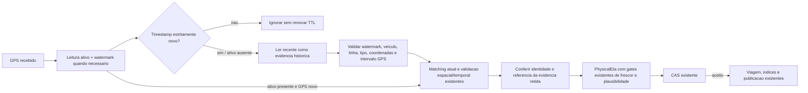

# Retencao de predecessor fisico BUS/BRT — 2026-10-19

Branch `audit/gps-bus-brt-pipeline`, base `869cf60`. Correcao local implementada e validada; sem deploy, push, producao, frontend ou retomada ETA/ML.

## Causa comprovada

O polling lia apenas `veiculo:{ordem}:ativo` para montar `LatitudeAnterior`, `LongitudeAnterior` e `TimestampAnterior`. Esse payload expira em 40s. O watermark numerico continua impedindo GPS repetido/antigo, mas nao contem coordenadas. O payload `recente` e a referencia temporal do enriquecedor ainda podem existir, sem que o polling forme o par fisico.

Assim, com aquisicoes espacadas em 45s/60s, `TemHistorico=false`, `MatchingOperacionalPlausivel=false` e o gate existente do PhysicalEta recusa a previsao. Nao e uma falha de deduplicacao nem prova de que o GPS do provedor tenha cadencia de 60s. A auditoria anterior encontrou 2.669/2.670 avaliacoes BRT sem predecessor; esse numero historico nao foi reamostrado nesta etapa.

Antes da mudanca funcional, a fixture executou o polling real, enriquecimento individual/lote e PhysicalEta, com cache expiravel e fontes/repositorios em memoria. Resultado RED: **8 falhas e 12 aprovados**. Todos os oito casos BUS/BRT de 45s/60s perderam o predecessor; os quatro de 30s passaram e os oito de 181s/240s permaneceram corretamente inelegiveis. TRX e hashes no JSON de validacao.

## Solucao pequena e separacao de responsabilidades

`GpsPhysicalPredecessor` usa a retencao ja existente de `recente` como evidencia historica. A separacao e de papel e validacao, sem criar outra chave, TTL, armazenamento, flag ou instancia de estado em memoria. O writer CAS ja grava ativo/recente com o mesmo JSON aceito e timestamp original.

O fallback so consulta `recente` quando ativo esta ausente/invalido, o watermark existe e o GPS recebido passou a deduplicacao. Leituras independentes sao paralelas e contabilizadas em `RedisLeiturasIniciais`. BUS com ativo valido segue o caminho anterior, sem leitura fisica adicional; duplicatas nao acionam esse fallback.

Um predecessor retido precisa ter:

- Timestamp GPS posterior ao Unix epoch, identico ao watermark lido, estritamente anterior ao GPS recebido, com intervalo **0 < dt <= 180s**. Esse teto acompanha o limite ja existente do PhysicalEta e independe da vida restante do cache.
- Mesma identidade fisica, codigo de linha e tipo de rota, coordenadas validas e captura original `Ativo`. Um payload explicitamente `SemSinal` nao e promovido.
- Para sustentar plausibilidade operacional, mesmos IDs nao vazios de linha, sentido, padrao e versao, mesma topologia e comprimento da geometria. A fracao e o timestamp anteriores do diagnostico do matching precisam corresponder exatamente a evidencia retida.

O matching atual continua sendo calculado pelo enriquecedor existente. Nao se copia uma projecao antiga para o GPS novo nem se reconstroi sua prova efemera a partir do JSON. Se a continuidade retida nao for comprovada, o polling desativa `MatchingOperacionalPlausivel` antes do PhysicalEta e da decisao operacional. O matching observacional atual permanece disponivel. A validacao espacial e os limites de progresso existentes continuam obrigatorios.

O DTO atual so nasce do GPS recebido com timestamp novo. Nao se substitui seu timestamp pelo relogio do servidor, nao se regrava `recente` por leitura e nao se renova ativo ao receber duplicata. Antes da nova observacao, o leitor oficial continua exibindo o payload recente como `SemSinal`. Frescor do ETA atual continua limitado pelo `MaxAgeSeconds` existente (90s na fixture e configuracao produtiva auditada).

## Antes/depois nas fixtures

Cada intervalo abaixo representa **4 combinacoes**: BUS/BRT x individual/lote, com matching valido, identidade continua, GPS atual fresco e movimento plausivel. Numerador = casos com predecessor / elegibilidade para ETA; primeira observacao de aquecimento excluida.

| Intervalo | Antes: predecessor / ETA | Depois: predecessor / ETA |
|---|---|---|
| 30s | 4/4 e 4/4 | 4/4 e 4/4 |
| 45s | 0/4 e 0/4 | 4/4 e 4/4 |
| 60s | 0/4 e 0/4 | 4/4 e 4/4 |
| 181s | 0/4 e 0/4 | 0/4 e 0/4 |
| 240s | 0/4 e 0/4 | 0/4 e 0/4 |

No RED, a assercao de predecessor interrompe os casos de 45s/60s; a inelegibilidade anterior do ETA tambem decorre diretamente do gate `predecessor_absent` no algoritmo original. O GREEN verifica explicitamente timestamp/posicao do predecessor, plausibilidade e ETA de **57,6s** para a distancia sintetica de 320m e velocidade de 20km/h. Isso demonstra disponibilidade na fixture, nao acuracia em viagens reais.

Casos adicionais finais: em 40s e 179s, 4/4 combinacoes preservam evidencia e ETA; em 180s, 0/4 porque a chave recente expira exatamente nesse instante na fixture. O teste isolado com JSON deliberadamente sem expiracao aceita dt=180s e recusa dt=180,001s: a politica fisica nao depende apenas do TTL. Lacunas nao sao preenchidas com posicoes fabricadas.

## Regressao e garantias

Todos os nomes abaixo pertencem a `NoPonto.Tests.GpsPhysicalPredecessorTests`:

| Requisito | Teste exato / evidencia |
|---|---|
| 30/40/45/60/179/180/181/240s; individual/lote; BUS/BRT; frescor visual separado | `FreshGps_AfterActiveExpiry_UsesBoundedPhysicalEvidence`: 32 casos, timestamps originais, ETA e expiracao ativo40 preservados; leitura oficial intermediaria `SemSinal` |
| Limite fisico independe do TTL | `PhysicalWindow_UsesGpsInterval_IndependentlyOfCacheLifetime`: -1/0/30/180/180,001s |
| JSON ausente/corrompido, veiculo/linha/modal/coordenadas/status, watermark ausente/divergente, identidade estrutural/projecao incompativel | `RetainedEvidence_MustMatchWatermarkIdentityAndLiveProjection`: 34 casos BUS/BRT, incluindo GPS velho ainda presente em cache |
| Duplicatas e fora de ordem | `DuplicateAndOutOfOrder_DoNotReadEvidenceRenewLivenessOrCommit`: zero matching/CAS adicional, nenhum GET fisico adicional e TTLs nao renovados |
| Linha, versao e sentido alterados | `NewLineOrItinerary_RequiresNewContinuityBeforeEta`: 12 casos, bloqueio inicial, limpeza do indice antigo e recuperacao somente na continuidade nova; consulta negativa do itinerario antigo programada explicitamente para respeitar a histerese existente |
| Reinicio sem referencia viva | `Restart_RequiresLiveProjectionWarmup_WithoutCopyingCachedMatching`: par fisico nao autoriza copiar matching; ETA so apos novo aquecimento |
| Novo timestamp ainda antigo em relacao ao relogio atual | `OldIncomingGps_RemainsIneligibleForEta_EvenWithPhysicalHistory`: historia nao remove o gate de 90s |
| Concorrencia apos leitura | `CasRace_DoesNotAdvanceOperationalStateOrRenewVisualCache`: candidato apto rejeitado pelo CAS nao avanca viagem nem renova payloads |
| Salto espacial, progresso implausivel, ausencia de avanco, terminal e wrap circular | `PhysicalSafetyGates_RemainRequired`: 10 casos, sem previsao indevida |

Total novo: **103 casos**. A suite oficial inclui tambem as regras existentes de viagem, fim/terminal, mudanca de itinerario, integridade circular, codec, PhysicalEta, GTFS, cadencia e deduplicacao. Esses algoritmos nao foram alterados. CAS Redis/Lua, IDs das fontes, normalizacao, DTO publico, TTLs e consumidores REST/SignalR permanecem iguais a `869cf60`; lista de fontes protegidas e hashes no JSON acompanhante.

Quatro cenarios existentes de `HistoricalEtaGtfsPollingTests.PollingContinuesWithIndependentShadow`, com `capture_without_active_predecessor`, assumiam que remover somente ativo eliminava toda evidencia fisica. Essa precondicao deixou de representar ausencia. A montagem agora remove tambem recente; as assercoes de ausencia, exportacao/diagnostico e flags permanecem intactas. O reaproveitamento de recente e coberto diretamente pela nova suite. Nenhum runtime Shadow/ML foi alterado ou ativado.

## Validacao executada

- SDK .NET 9.0.306, xUnit/VSTest; fixtures inspecionadas antes da execucao. Todas as novas dependencias de I/O sao fakes em memoria. Sem iniciar API, HTTP externo, Redis/PostgreSQL real, Docker ou migrations. Avanco de tempo do cache e dos timestamps GPS sem sleeps; o check existente de idade do PhysicalEta usa relogio real com margem ampla nas fixtures.
- RED dirigido antes do codigo funcional: 12 aprovados / 8 falhas esperadas / 0 ignorados. GREEN inicial: 20/20. Expansao inicial: 70/74; quatro fixtures de troca foram corrigidas para retornar `NotEligible` para a versao anterior em vez do default de falha de infraestrutura do fake, preservando a regra de histerese. Rodada seguinte: 96/96.
- Primeira selecao oficial ampliada: 729/733, com as quatro precondicoes antigas de ausencia descritas acima; sem outras falhas. Versao final acrescenta tambem cinco limites temporais e dois casos de GPS antigo (103 novos no total).
- Build Release da solucao, `--no-restore --no-incremental`: **0 erros**, cinco avisos anteriores (CS8981 x2, CS7022, xUnit2031 x2).
- Selecao gerada por `.ci/offline_tests.py filter`, execucao Release `--no-build --no-restore`, TRX `predecessor-offline-final.trx`: **738 aprovados, zero falhas/ignorados**. `.ci/offline_tests.py verify` confirmou contagens, todas as 27 classes presentes e ausencia de testes fora da allowlist. `git diff --check` aprovado.
- O primeiro comando Python foi bloqueado pela sandbox; repetido com aprovacao, sem trocar interpretador, alterar ACL ou contornar isolamento.

Artefatos locais ignorados: `NoPonto/lab-output/gps-predecessor-fix-20261019/`. Agregado versionado: [gps-predecessor-validation-20261019.json](gps-predecessor-validation-20261019.json).

## Riscos e proxima etapa

- Disponibilidade de ETA foi recuperada nas fixtures. Nao ha nova medida de cobertura/precisao produtiva, nem extrapolacao de sampling historico de 10% para cadencia ou cobertura integral.
- Recent180 e um teto de retencao, nao garantia de predecessor. Expiracao, eviction, falha de leitura, watermark divergente, matching incompleto, reinicio e intervalo GPS >180s mantem previsao indisponivel. Erro de I/O na leitura continua abortando o ciclo pelo tratamento existente; nao se inventa evidencia.
- O vinculo com matching confirmado e conservador: divergencia de timestamp/fracao/identidade requer aquecimento. Mudancas frequentes de itinerario e outras causas operacionais observadas na auditoria continuam podendo limitar o ETA.
- As verificacoes entre reads nao sao uma transacao: o watermark igual ao payload limita mistura e o CAS final continua sendo a autoridade. Teste de concorrencia usa repositorio em memoria; atomicidade/fencing do Lua foram revisados e preservados, nao reexecutados em Redis conectado.
- Nao se alterou a formula/velocidade do PhysicalEta, gates de fim/terminal, matching ou frontend. Recuperar elegibilidade nao certifica estimativa correta de chegada.
- Proximo passo recomendado: validar o fluxo em homologacao descartavel com Redis/PostGIS reais, inclusive fencing e mudanca de itinerario; depois avaliar a divergencia operacional `ItineraryChanged` com evidencia causal. Observacao produtiva e eventual deploy exigem etapa operacional autorizada separadamente.
