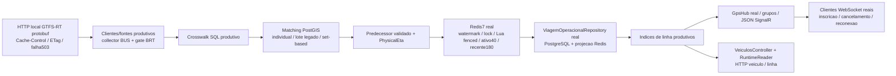

# Homologacao integrada GPS BUS/BRT — 2026-10-19

Base: `098852b`, incluindo `869cf60`, branch `audit/gps-bus-brt-pipeline`. **Nenhum algoritmo funcional foi alterado.** Somente testes, runner descartavel, evidencias e historico. Sem deploy/push, producao, frontend WIP ou retomada ML.

## Resultado

As duas correcoes funcionaram juntas com HTTP, PostgreSQL/PostGIS, Redis/Lua, repositorio operacional, REST e consumidores WebSocket SignalR reais. Foram comprovadas duas lacunas de entrega ao consumidor: **ausencia de remocao via SignalR** e **divergencia Ativo/SemSinal entre REST e broadcast nas duplicatas**. Os testes de caracterizacao aprovados registram requisitos nao atendidos; nao significam aprovacao geral do produto.

- Integracao completa: **9/9 casos aprovados**, zero ignorados, incluindo janela de60s sem modificar TTLs Redis.
- Complemento com lote **set-based**, conforme a configuracao produtiva auditada: **8/8 aprovados**, zero ignorados. O caso longo usa matching individual, cujo caminho nao mudou, e nao foi repetido.
- Build Release final `--no-restore --no-incremental`: zero erros, cinco avisos anteriores. Selecao oficial `.ci/offline_tests.py filter`/`verify`: **738/738 offline aprovados**, zero ignorados,27classes presentes. A classe conectada permanece fora da allowlist.

## Isolamento comprovado

Runner `tools/gps/test_pipeline_disposable.ps1`, reaproveitando o padrao de guards existente e `ViagemOperacionalFixture`, inspecionada antes de executar suas migrations/seed/drop de schema.

- Docker Desktop local `desktop-linux`, named pipe validado; contexto remoto proibido, sem trocar configuracao Docker.
- Imagens existentes `postgis/postgis:16-3.4` e `redis:7.4-alpine`, `--pull never`, sem build de imagem.
- Bridge, nomes e labels exclusivos por execucao; nenhum container anterior anexado. Portas aleatorias verificadas em **127.0.0.1**. Bridge exclusiva nao e rede Docker `--internal` nem ambiente sem possibilidade de saida; o harness usa somente endpoints locais explicitos.
- Dados apenas em tmpfs, sem binds/volumes persistentes. Limites: PG512MiB/1CPU/160PIDs; Redis96MiB/0,5CPU/64PIDs.
- Banco exclusivo `noponto_gps_fixture`, schema unico migrado; guards independentes no PostgreSQL e Redis, conferidos **antes de qualquer migration, seed ou limpeza**. Sem defaults para servicos de desenvolvimento.
- Kestrel local em porta dinamica, configuracao externa removida e provider em memoria. `Program.cs`, `.env`, workers e servicos externos nao sao iniciados.
- Teardown somente dos IDs criados e apos conferir labels; `--rm`, rede propria removida e variaveis do processo restauradas. Sem prune, flush global ou compose down.
- Todas as rodadas preservaram os **quatro containers anteriores**: mesmos IDs, inicio, restart count e estado running. Zero containers/redes da fixture restantes; nenhum acesso aos bancos Redis/Postgres anteriores.

A primeira tentativa com rede interna nao disponibilizou as portas esperadas; o guard recusou a porta PG default antes de abrir conexao. Houve teardown completo. Adotada bridge exclusiva com verificacao explicita de bindings. A segunda montagem passou guards/migrations/CAS e bloqueou os demais casos por provider ausente no host da fixture; ajustado somente no teste. Rodada rapida seguinte8/8. Esses bloqueios de montagem nao sao defeitos GPS.

## Fluxo exercitado

Geometrias/identidades sao sinteticas e exclusivas. Crosswalk, matching e repositorios nao sao simulados; observadores encaminham todas as decisoes aos componentes reais. Apenas o provedor externo e substituido por HTTP local controlado. ML desabilitado.

Fixture: polling15s, gateBRT20s, clienteHTTP30s, ativo40s, recente180s, PhysicalEtaON/MaxAge90s, paralelismos4, enriquecer todas as linhas. No complemento, `Enabled=true` e `CombinadoSetBasedEnabled=true` sao passados tanto ao enriquecedor como ao repositorio. A rodada completa anterior tambem exercitou lote legado.

## Matriz e relogios

Nos testes rapidos, GPS/cacheHTTP avancam explicitamente e os TTLs de **chaves conhecidas da fixture** sao reduzidos via `EXPIRE`, com expiracao efetiva no Redis. Isso comprime lacunas de240s. Nao mede latencia/cadencia do provedor real.

Matriz final set-based: cada linha tem4combinacoes (BUS/BRT x individual/lote). Primeira observacao de aquecimento excluida:

| Intervalo GPS | Predecessor | ETA | GPS novo no REST/SignalR |
|---|---|---|---|
| 30s | 4/4 | 4/4 | Ativo, timestamp preservado |
| 45s | 4/4 | 4/4 | Ativo, timestamp preservado |
| 60s | 4/4 | 4/4 | Ativo, timestamp preservado |
| 240s | 0/4 | 0/4 | Ativo somente pela nova observacao, sem inventar historia |

Ensaio conjunto acelerado90s: GETsBUS0/30/60/90, BRT0/45/90; os dois sucessores BRT tiveram predecessor/ETA. Cache-Control30 com headers+1s no relogio controlado nao voltou a sofrer a espera duplicada do gate.

O teste `RealExpiryAndAcquisition_OverSixtySeconds_KeepRecentHistorical` **nao altera TTLs**: aguarda tempo de parede em15/30/45/60s e consulta REST aos41s. HTTP/Redis/SQL sao reais; apenas o relogio de cache do provedor continua controlado para reproduzir deterministicamente headers+1s.

| Evidencia real observada | Resultado |
|---|---|
| Aos41,031s | Ativo BRT ausente; REST `SemSinal`; GPS original preservado |
| Recente aos41s | TTL138,943s, sem renovacao pela leitura |
| Novo GET/aceite BRT | 45s; predecessor com deltaGPS45s recuperado |
| ETA BRT apos45s | 28,6257s, recebido no WebSocket e preservado no REST |
| GETs no ensaio60,079s | BUS0/30/60; BRT0/45 |

As distancias/ETAs sao de geometria sintetica calculada pelo PostGIS; nao representam acuracia de chegada real.

## Falhas, causas e prioridades

| Prioridade | Esperado | Observado / causa | Menor alteracao proposta, nao implementada |
|---|---|---|---|
| P1 | Consumidor remover veiculo expirado/movido de linha | REST404/linha vazia, nenhum frame de remocao ao grupo antigo ainda inscrito. Outra fonte mantem o ciclo ativo. Passo8 do polling publica somente `Count>0` e ignora indice ausente. | Snapshot vazio explicito para linhas inscritas vazias, incluindo grupo antigo, indice ausente e retornos antecipados. Confirmar reconciliacao pelo consumidor. |
| P2 | REST/SignalR representarem a mesma disponibilidade | Duplicata: REST/Redis ainda Ativo; broadcast SemSinal. Broadcast usa aceitos do ciclo e carrega demais ordens exclusivamente de recente, sem consultar ativo. | Reaproveitar leitura oficial ativo-primeiro/recente-SemSinal para o snapshot de broadcast, preservando dedup/TTL. |
| P2 | Continuidade operacional em troca de itinerario | Resultados reais Created/Updated e depois ItineraryChanged; nenhuma reancoragem artificial. Fixture usa MudancaOperacionalHabilitada=false default. ETA fisico pode voltar com novo matching continuo sem resolver viagem antiga. | Auditar politica/flag/evidencias de transicao; nao converter rejeicoes em Updated nem afrouxar identidade. |
| Investigacao | Explicar contadores produtivos zerados | Zero sem inscritos; positivos com inscritos e frames recebidos. Dois clientes recebem, cancelamento de um preserva outro; reconexao com nova inscricao recebe no ciclo seguinte. | Correlacionar conexao, rota do hub, inscricao concluida e ciclo com cliente identificado. Causa produtiva individual permanece desconhecida. |

O polling tambem retorna antes do broadcast se nao ha posicoes ou todas sao descartadas por idade. Remover apenas o `if (Count>0)` nao cobre esses caminhos; este complemento foi revisado no codigo, sem alegar ensaio de expirada global nao realizado.

O protocolo tem `PosicaoAtualizada`, sem evento separado de remocao. A evidencia e do WebSocket, nao da renderizacao React Native. Frontend WIP nao foi aberto/alterado. A auditoria24 ja aponta risco de conservar marcadores em lista vazia; validar o consumidor em etapa propria.

## Testes nominais e evidencias

Todos em `NoPonto.Tests.GpsPipelineDisposableIntegrationTests`:

| Requirement | Evidence |
|---|---|
| BUS/BRT, intervalos, individual/lote, REST/SignalR | `BusBrtMatrix_RealHttpSqlCasRestAndSignalR` (2 casos x8pares) |
| CacheHTTP/gate/predecessor juntos | `CadenceAndPredecessorTogether_RespectHttpCacheWithoutSecondGate` |
| TTL40 real e ETA entregue | `RealExpiryAndAcquisition_OverSixtySeconds_KeepRecentHistorical` |
| Dois consumidores, reconexao, status e falta de remocao | `SignalR_TwoConsumersReconnectAndExpiry_RecordMissingRemoval` (caracterizacao de falhas) |
| Linha/sentido/versao, aquecimento e indice antigo | `RouteDirectionVersionAndTerminal_KeepSafetyGates` (BUS/BRT) |
| FalhaHTTP, fora de ordem, GPS antigo e terminal Finalizada sem ETA | `TerminalOldGpsAndHttpFailure_DoNotInventEta` |
| CAS concorrente/duplicata/foraordem/fencing sem renovar payload | `RedisCas_ConcurrentDuplicateOutOfOrderAndFencingAreAtomic` |

Agregado versionado: `gps-integrated-validation-20261019.json`: TRX/hash, observacoes sinteticas, isolamento/teardown e fontes runtime iguais a098852b. Artefatos locais ignorados: `NoPonto/lab-output/gps-integration-20261019-{smoke,smoke2,smoke3,final,setbased,offline}`. Nao somar rodadas como casos unicos.

Reproducao: `pwsh -NoProfile -File tools/gps/test_pipeline_disposable.ps1 -Run -ResultsDirectory D:/caminho/absoluto/novo/gps-homologacao`. O diretorio precisa ser novo. Runner recusa contexto remoto, imagem ausente, bindings invalidos e mounts persistentes. Nunca executar estas fixtures diretamente com defaults de desenvolvimento.

## Limites e proxima etapa

Validacao de componentes deste checkout com dados sinteticos; nao certifica imagem implantada, proxy/TLS/autenticacao de borda, backplane/multiplas instancias, frota/carga de pico, API externa ao vivo, APK/mapa ou reinicio integral dos processos/containers. O teste chama o ciclo produtivo, sem iniciar todos os background services. Sampling historico10% nao participa da matriz nem vira cobertura produtiva.

Priorizar contrato de remocao/status SignalR com regressao no fio e consumidor identificado; depois investigar ItineraryChanged preservando os bloqueios seguros. Nenhuma dessas correcoes foi implementada ou implantada.
