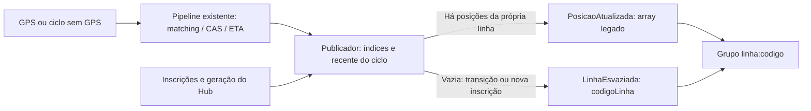

# Remoções GPS por linha no SignalR — 2026-10-20

Base: `30bc424`, branch `audit/gps-bus-brt-pipeline`. Correção local, sem deploy, produção, frontend ou retomada ML. Evidências agregadas: [gps-signalr-removal-validation-20261020.json](gps-signalr-removal-validation-20261020.json).

## Causa comprovada e regressão

O polling montava `PosicaoAtualizada(posicoes[])` somente quando havia índice Redis **e** a lista final continha veículos. Após expiração de `:recente` ou retirada do último veículo da linha, nenhum evento era enviado. Os retornos por ausência completa de GPS e por filtro de idade também pulavam a publicação. O cliente mantinha seu último snapshot indefinidamente. O contrato de array sem contexto não permite distinguir uma linha vazia entre várias inscrições.

Antes da correção, a nova asserção em `SignalR_TwoConsumersReconnectAndExpiry_DeliverIdentifiedRemoval` falhou esperando `LinhaEsvaziada`, com Redis/PostGIS e WebSocket reais: REST vazio, consumidor ainda inscrito, outra fonte mantendo o polling. O timeout de 5s ocorreu em `WireClient.NextEmpty`, depois das asserções de REST e preservação do evento legado. Nenhum runtime havia sido alterado nessa rodada.

Há também índices que podem sobreviver ao payload ou apontar para um veículo já transferido. A publicação agora confere `CodigoLinha` no payload recente antes de incluí-lo. O teste de troca BUS/BRT recoloca deliberadamente o índice antigo e comprova que não há vazamento para o grupo anterior. Isso não modifica os índices nem o leitor REST.

## Contrato e implementação

Preservado: `PosicaoAtualizada(posicoes[])`, com o mesmo DTO de compatibilidade, aliases e comportamento de status anteriores, sempre não vazio. Adicionado:

```text
target:    LinhaEsvaziada
arguments: [{ "codigoLinha": "BRT10" }]
group:     linha:BRT10
```

É um snapshot vazio **da linha identificada**, não uma remoção global. O código segue a normalização já existente do Hub: trim e uppercase. Consumidores antigos continuam recebendo o evento legado e podem ignorar o adicional; precisam adotá-lo para efetivamente remover marcadores quando a linha esvazia.

`GpsSignalRPublisher` reúne a publicação que antes estava no polling e é chamado após commits/índices e nos dois retornos sem posições utilizáveis. Mantém a leitura recente limitada ao ciclo e a projeção legada. Sem assinantes, não faz leituras Redis nem broadcasts. Índice ausente é tratado como snapshot vazio explícito.

O Hub conserva os grupos existentes e associa uma geração a cada inscrição nova. Inscrição idempotente não altera a geração; cancelamento seguido de inscrição, nova conexão e reconexão com reinscrição alteram. O publicador envia vazio na primeira observação, na transição de não vazio para vazio ou quando entra um novo assinante. Na linha já vazia, uma nova inscrição provoca um único refresh do grupo, permitindo sincronizar o novo consumidor. Não há repetição a cada polling.

O marcador de vazio só é confirmado após `SendAsync` terminar com sucesso; falha de envio permite retry no próximo ciclo. Ele é descartado quando há posições ou não há assinantes. A estrutura é concorrente porque os envios de grupos distintos podem concluir em paralelo; os ciclos do polling continuam seriais. Não há novas chaves Redis, flags, dependências, schema ou serviços de DI.



## Resultados antes/depois

| Cenário | Antes | Depois |
|---|---|---|
| Última posição expira, com outra fonte ativa | REST vazio; nenhum evento de remoção | Evento identificado no grupo correto |
| Último veículo muda de linha, BUS e BRT | Índice anterior limpo; consumidor anterior sem remoção | Grupo anterior recebe vazio; novo grupo recebe o veículo |
| Índice antigo recolocado após transferência | Payload recente de outra linha podia ser publicado | Linha do payload validada; nenhuma posição no grupo errado |
| Ausência de GPS ou todas as posições rejeitadas por idade | Retorno antes do broadcast | Snapshot Redis observado e vazio comunicado, sem beacon de outra fonte |
| Primeira inscrição em linha sem índice/GPS | Silêncio | Um vazio identificado |
| Linha permanece vazia | Silêncio não distinguia vazio de falta de publicação | Vazios repetidos suprimidos; nova inscrição/reconexão recebe refresh |
| Só ativo expira, recente ainda válido | Histórico pode ser mostrado SemSinal | Mantido; nenhuma remoção prematura |
| Cancelamento de um consumidor entre vários | Demais assinaturas preservadas | Preservado; cancelado não recebe remoção da linha |

Integração completa: **14/14 aprovados**, zero falhas/ignorados. Inclui os nove casos anteriores, agora exigindo remoções, mais cinco casos de ciclo vazio e inscrições. Seleção oficial offline: **747/747 aprovados**, 28 classes, verificação `.ci/offline_tests.py verify` aprovada; nove casos novos do publicador. Compilação Release durante os testes: zero erros e os cinco avisos anteriores. Houve um erro de compilação inicial apenas no fake `IHubClients` dos testes, corrigido antes dessas rodadas.

O ensaio integrado de 60s manteve os TTLs reais. A matriz controlada continua cobrindo 30/45/60/240s em BUS/BRT e matching individual/lote: predecessor/ETA nos intervalos permitidos, lacuna prolongada sem ETA, timestamps intactos. Permanecem as asserções reais de CAS concorrente, rejeição de duplicata/fora de ordem/fencing e payload/TTL preservados. Nenhuma conclusão de acurácia de ETA ou frequência produtiva é inferida dessas fixtures.

## Matriz de requisitos e testes exatos

Os métodos abaixo pertencem a `NoPonto.Tests.GpsPipelineDisposableIntegrationTests`, exceto onde indicado.

| Requisito | Evidência |
|---|---|
| Expiração e remoção com duas conexões e reconexão | `SignalR_TwoConsumersReconnectAndExpiry_DeliverIdentifiedRemoval` |
| BUS/BRT, várias linhas por consumidor, cancelamento, recente sem remoção prematura, nova inscrição e supressão | `SignalR_ExpiryWithOtherLiveLine_IsolatedAndResynchronized` (BUS/BRT) |
| Ambos os retornos antecipados, índice ausente e nenhuma outra fonte ativa | `SignalR_NoGpsEarlyReturns_ExpireWithoutUnrelatedBeacon` (false/true) |
| Linha nunca vista, ausência total de GPS, HTTP503 e refresh de novo consumidor | `SignalR_ColdEmptySubscriptionAndHttpFailure_OneRefreshPerSubscription` |
| Mudança de linha/sentido/versão, aquecimento seguro, índice antigo e ausência de vazamento | `RouteDirectionVersionAndTerminal_KeepSafetyGates` (BUS/BRT) |
| HTTP503 com estado recente preservado, timestamps repetidos/fora de ordem e terminal sem ETA | `TerminalOldGpsAndHttpFailure_DoNotInventEta` |
| TTL real e aquisição/predecessor juntos | `RealExpiryAndAcquisition_OverSixtySeconds_KeepRecentHistorical`; `CadenceAndPredecessorTogether_RespectHttpCacheWithoutSecondGate` |
| Intervalos 30/45/60/240, CAS, identidade e ETA nas leituras REST/SignalR | `BusBrtMatrix_RealHttpSqlCasRestAndSignalR` (false/true); `RedisCas_ConcurrentDuplicateOutOfOrderAndFencingAreAtomic` |
| Identificação de grupo, refresh e ausência de repetição vazia | `GpsSignalRPublisherTests.EmptySnapshots_IdentifyGroupsAndSuppressUntilSubscriptionChanges` |
| Array legado, payload/timestamp/status mantidos e transições para vazio | `GpsSignalRPublisherTests.NonemptyThenExpired_PreserveLegacyAndClearOnlyOwningLine` (BUS/BRT) |
| Índice incorreto com leitura recente compartilhada | `GpsSignalRPublisherTests.TransferredVehicleInStaleIndex_OnlyPublishesCurrentLine` |
| Payload recente ausente, nulo ou corrompido | `GpsSignalRPublisherTests.MissingOrInvalidRecent_ProducesIdentifiedEmpty` (3 casos) |
| Falha de envio com retry; ausência de assinantes sem I/O e sem estado retido | `GpsSignalRPublisherTests.FailedEmptySend_IsRetriedThenSuppressed`; `GpsSignalRPublisherTests.NoSubscribers_DoesNoRedisReadsOrSends_AndReleasesSuppression` |

## Frontend: adaptação necessária, não implementada

Consulta somente leitura ao repositório vizinho, incluindo o WIP. `src/services/gpsHub.ts` registra apenas `PosicaoAtualizada` e distribui arrays aos listeners; `src/hooks/useMobilidadeRio.ts` reconcilia as posições e linhas disponíveis; `src/services/veiculosMapa.ts`, em `reconciliarSnapshotsRodoviarios`, não conhece a linha de um array vazio e pode preservar posições pela política de presença do WIP.

A próxima alteração do frontend precisa:

1. Registrar `LinhaEsvaziada` e propagar `{ codigoLinha }` como operação explícita, validando/normalizando o código. Não converter o evento em `handleRealtime([])`.
2. Remover do estado somente veículos daquela linha e atualizar os dados derivados relevantes. Preservar as outras linhas e a seleção/favoritos do usuário.
3. Aplicar essa operação também à camada de presença/retenção e ao estado enviado ao mapa, impedindo que um snapshot anterior recoloque marcadores removidos. Coordenar respostas REST em andamento com a reconciliação existente; o evento não é um tombstone permanente, uma posição nova legítima deve reaparecer.
4. Manter o listener antes de conectar/inscrever e reinscrever após reconexão, como já faz o serviço. Ao cancelar uma linha, limpar o estado local correspondente: o servidor corretamente deixa de enviar eventos ao consumidor cancelado.
5. Testar remoção de apenas uma entre várias linhas, BRT/BUS, transferência, cancelamento, reconexão, presença do WIP e reaparecimento legítimo.

O backend não consegue apagar marcadores de um cliente antigo que ignora o evento. Esta entrega prepara o contrato e comprova o recebimento por WebSockets; não certifica a UI atual.

## Limites e prioridades

- **P1:** adaptar e testar o consumidor antes de usar a correção para certificar remoção na UI. Nenhum arquivo do frontend foi modificado.
- **P2 anterior preservado:** em GPS duplicado, REST pode dizer Ativo e SignalR SemSinal, pois o broadcast segue aceitos do ciclo + recente. Não foi introduzida leitura ativo-primeiro nem alteração de status/TTL nesta etapa.
- Sem ACK de aplicação ou replay durável. `SendAsync` bem-sucedido confirma o envio pelo servidor, não a aplicação pela UI. Reconexão exige reinscrição e sincroniza no próximo ciclo; com polling atrasado/falhando não há SLA de remoção imediata.
- Registro de assinaturas e supressão continuam locais ao processo. Backplane, múltiplas réplicas, proxy/APK e carga de pico não foram validados. Os contadores positivos/zerados seguem a presença de assinantes na fixture; a causa dos zeros produtivos não foi provada aqui.
- Cache e TTLs mantidos: ativo40s/recente180s; recente não é promovido a ativo. Sem alterações em CAS, deduplicação, matching, predecessor, ETA, terminal, aquisição, REST ou regras de viagem. Fontes protegidas comparadas com a base no agregado.
- Runner descartável existente, imagens locais, rede exclusiva, loopback aleatório e tmpfs. Nas duas rodadas, os quatro containers anteriores preservaram início/restarts/running; zero containers e rede próprios restantes. Sem conexão a bancos preexistentes, deploy, push, migration produtiva ou retomada ML.

Reprodução: usar `tools/gps/test_pipeline_disposable.ps1 -Run` com `ResultsDirectory` novo para integração; offline pela allowlist oficial. Os TRXs/JSONL brutos ficam em `NoPonto/lab-output` ignorado; o agregado versiona somente hashes, resultados e observações sintéticas sanitizadas.
