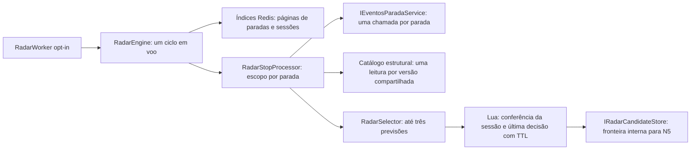

# Radar de Espera — N4-B

Base N4-A `ede383f0e6a0fb482f936ee1ff13a854eb353fee`, branch `feat/radar-notificacoes`.
Commit de implementação: `e5f8933b393cb7ea32d1ff54bb5c81ba7b14411a`. A revisão documental posterior registra este hash sem modificar o código validado.

## Resultado e homologação Redis 7

Implementado motor compartilhado por parada e armazenamento interno da última decisão candidata. **Não envia notificações**. Nenhum endpoint público novo, token Expo/FCM, áudio, alteração de frontend, GPS, ETA, SignalR, banco/schema/migration, deploy ou acesso produtivo.

**Homologação Redis 7 real: NÃO REALIZADA.** `docker version` não conseguiu conectar ao pipe `dockerDesktopLinuxEngine`; Docker Desktop parado. `wsl --list --verbose` mostrou somente `docker-desktop`, também parada. `redis-server` não está no PATH. Não foram iniciados Docker Desktop/distribuições/containers existentes, nem acessados Redis Debian, SSH, ngrok ou credenciais reais. A API completa não foi iniciada, evitando seu bootstrap/migrations.

Os testes originais N4-A foram preservados e reexecutados com StackExchange.Redis e os scripts Lua, **somente contra emulador descartável** (`fakeredis 2.40.0`, `lupa 2.8`, helper N4-A em loopback). Isso verifica a lógica isolada, não substitui compatibilidade, atomicidade, TTL ou desempenho de Redis 7 verdadeiro. O modo emulado de handshake já existente na N4-A permanece restrito aos fixtures. Nenhum teste N4-A foi alterado para esconder incompatibilidades.

Quando Redis 7 local descartável estiver disponível, executar a mesma seleção de testes com `NOPONTO_RADAR_TEST_REDIS` apontando exclusivamente para a instância criada para a tarefa e **sem** `NOPONTO_RADAR_TEST_EMULATED`. Não usar containers compartilhados nem iniciar a API completa. Conferir versão pelo Redis descartável e registrar nova evidência antes de declarar homologação real.

## Arquitetura



`RadarEngine` é singleton, com um semáforo para o ciclo inteiro. Cada parada usa `CreateAsyncScope`: eventos e catálogo compartilham o DbContext daquele escopo, em operações sequenciais. Paradas distintas podem executar em paralelo até o limite. Nenhuma dependência de `GpsPollingService`, fila de GPS ou Hub foi adicionada. O único serviço de chegada consumido é `IEventosParadaService.ListarAsync`, o mesmo do `GET /paradas/{id}/eventos`, chamado diretamente em memória; suas regras físicas, híbridas e ferroviárias permanecem intactas.

Fluxo por parada:

1. Ler uma página limitada de sessões, conferindo estado, proprietário, instalação e prazo em Lua.
2. Selecionar sessões cujo conjunto de versões cabe no orçamento estrutural. Uma sessão que exceda o orçamento é adiada integralmente.
3. Consultar eventos **uma vez** para toda a parada. Se a resposta superar o teto, descartar o processamento dessa parada e contabilizar saturação; não truncar e esconder prioridades.
4. Após a consulta de eventos, conferir a parada e cada versão distinta no catálogo existente: versão atual, linha, sentido, padrão e ocorrência da parada. Conservar apenas vínculos resumidos, sem cache de geometria entre sessões/ciclos.
5. Filtrar e selecionar em memória para cada sessão válida. Antes de gravar, Lua compara novamente instalação válida, proprietário, identidade, parada, estado ativo, revisão e expiração.

Assim, 100 sessões na mesma parada/contexto fazem **uma chamada ao serviço de eventos e duas ao catálogo** (parada + versão), e não 100 consultas de chegada ou de itinerário. Essas são contagens de invocações de interfaces: o serviço de eventos e o repositório podem executar vários comandos SQL internamente. Não se afirma que toda a parada custa um único SQL.

## Seleção e semântica

- Ordenar pelo instante previsto, preservando a chegada mais próxima.
- Reservar uma vaga à primeira linha prioritária elegível.
- Se houver pelo menos duas linhas prioritárias elegíveis e uma alternativa não prioritária, reservar também uma vaga à alternativa quando ela ainda não estiver representada.
- Completar até três itens por proximidade; diversidade de linha desempata instantes iguais. Ordenar a saída final por tempo.
- Deduplicar evento/veículo da mesma linha; **não** deduplicar uma linha inteira. Veículos diferentes podem ocupar várias vagas.

A reserva de alternativa explícita atende à regra N4-B inclusive quando as três prioridades chegam antes da alternativa. Nenhuma mudança correspondente foi feita no frontend nesta execução; alinhar esse caso na integração.

Os instantes vêm somente de `EstimatedAt`, `ScheduledAt` ou da duração `SecondsUntilEvent` já fornecida pelo contrato, ancorada no instante usado na consulta. Não há velocidade, distância, média ou fórmula de ETA nova. Previsão passada, fora da janela de 2–15 minutos, consulta vencida, evidência futura/antiga, contexto incompatível ou qualidade indisponível não produz item. Fontes físicas/híbridas exigem evidência e qualidade compatíveis; o prazo de evidência respeita `PhysicalEta:MaxAgeSeconds`, limitado também aos 300s do Radar do frontend. Fontes não físicas têm teto de 300s; programação sem evidência só é aceita com horário programado e qualidade `ScheduleOnly`/`ScheduleAnchored`. Qualidades desconhecidas, `StalePrediction` e `HistoricalFallback` são rejeitadas de forma conservadora.

Cada item tem `confirmacao="previsao"`, além de `source` e `quality` originais. Programação ferroviária não vira prova física. `ARRIVAL` continua chegada prevista e `DEPARTURE` continua saída prevista. Sem previsão explícita de saída, não é fabricado horário.

**Lacuna de terminal:** `IEventosParadaService` não fornece o conjunto de presenças físicas reconciliadas, espera, dwell ou confirmação operacional que o frontend obtém por outros contratos. Por isso `presencaTerminalDisponivel=false`; o motor não anuncia presença nem inventa reconciliação de terminal a partir de ETA. Esse alinhamento permanece pendente para integração futura.

## Contrato interno e validade

`IRadarMonitorStore` oferece páginas internas de paradas e sessões. `IRadarCandidateStore.TentarGravarAsync` é a fronteira de produção de decisões; `LerAtualAsync(instalacao)` devolve somente a última decisão ainda compatível com a sessão/instalação. Não há controller ou autorização por ID público para essas interfaces.

Exemplo conceitual de `RadarConteudoCandidato` (IDs e dados sintéticos):

```json
{
  "sessaoId": "bbbbbbbb-bbbb-bbbb-bbbb-bbbbbbbbbbbb",
  "instalacaoId": "aaaaaaaa-aaaa-aaaa-aaaa-aaaaaaaaaaaa",
  "revisao": 3,
  "paradaId": "20000000-0000-0000-0000-000000000002",
  "paradaNome": "Bom Repouso sintético",
  "consultadoEm": "2026-11-06T18:00:00+00:00",
  "geradoEm": "2026-11-06T18:00:00+00:00",
  "validoAte": "2026-11-06T18:00:45+00:00",
  "itens": [{
    "eventoId": "evento-sintetico",
    "linhaId": "10000000-0000-0000-0000-000000000001",
    "codigoLinha": "884",
    "veiculoId": "veiculo-sintetico",
    "tipoEvento": "ARRIVAL",
    "previstoEm": "2026-11-06T18:02:00+00:00",
    "etaSegundos": 120,
    "prioritaria": false,
    "source": "PhysicalCausal",
    "quality": "estimativa_fisica",
    "evidenciaEm": "2026-11-06T17:59:55+00:00",
    "confirmacao": "previsao"
  }],
  "adicionais": 0,
  "presencaTerminalDisponivel": false
}
```

Conteúdo vazio substitui uma decisão anterior quando uma consulta válida não possui candidatos. Não é uma instrução de envio. Para conteúdo com itens, o tempo de validade é o menor entre TTL configurado, expiração da sessão, validade da consulta, evidência dos itens e primeiro instante previsto; Lua limita ainda pela credencial e impõe teto de 120s. Leituras nunca renovam esse prazo.

Escrita tardia de sessão encerrada, expirada, revogada, reconfigurada ou movida é recusada. A leitura também confere identidade/revisão/proprietário e elimina conteúdo obsoleto. `consultadoEm` impede uma consulta mais antiga de sobrescrever uma decisão mais recente da mesma sessão. Os dados não incluem credencial/verificador ou token push. N5 deverá usar a interface validada e revalidar no momento de envio; ler a chave bruta não oferece esse contrato.

## Redis e paginação

Reutilizados integralmente os índices e o namespace N4-A `noponto:radar:v1:{radar}:`, sem SCAN/KEYS ou consulta SQL por proprietário.

| Sufixo novo | Estrutura | Retenção |
|---|---|---|
| `worker:cursor:stops` | posição de página do diretório de paradas | 2h |
| `worker:cursor:{paradaN}` | posição de página das sessões da parada | 2h |
| `candidate:{instalacaoN}` | hash: content, expires, observed | padrão até 45s; teto 120s e limitado pela sessão/instalação |

Paginação por rank rotativo após poda de scores vencidos: suporta empates de score, limita referências examinadas e evita sempre começar no mesmo proprietário. Mesmo uma página que cobre todos os membros rotaciona o início, permitindo adiar sessões por orçamento de contexto sem excluí-las permanentemente. Sob alterações concorrentes do índice, páginas podem revisitar/pular referências temporariamente; não há promessa de exatamente uma execução ou SLA de atendimento quando o orçamento é insuficiente. Índice vazio, referência ausente, proprietário incorreto e instalação/sessão vencida são descartados em Lua.

A gravação do último candidato é atômica com a conferência de instalação/sessão corrente. Os scripts N4-A não foram alterados: após encerramento/revogação pode restar fisicamente um candidato até seu TTL, mas a leitura validada não o devolve. Não existe lista histórica nem fila de notificações. Redis standalone permanece o alvo; Cluster não foi homologado.

## Worker, limites e consumo

```json
{
  "Radar": {
    "Enabled": false,
    "WorkerEnabled": false,
    "IntervalSeconds": 30,
    "MaxParadasPorCiclo": 20,
    "MaxSessoesPorCiclo": 500,
    "MaxSessoesPorParada": 200,
    "MaxContextosPorParada": 80,
    "MaxEventosPorParada": 500,
    "MaxConcorrencia": 2,
    "QueryTimeoutSeconds": 5,
    "CandidateTtlSeconds": 45
  }
}
```

São defaults de proposta, sem configuração operacional aplicada. Ambos os flags precisam estar ativos. Desabilitado, o hosted service termina sem resolver motor/Redis/eventos ou iniciar temporizador. Habilitado, aguarda o término de um ciclo e só então espera 30s: não acumula ticks atrasados. Chamadas concorrentes do motor são descartadas pelo gate; não há canal pendente ilimitado nem `Task.Run` destacado.

O orçamento global de sessões é repartido antes do fan-out, limitado também pelo teto por parada. Duas paradas no máximo usam escopos simultaneamente. O timeout de 5s cobre o processamento daquela parada e cancela cooperativamente Redis, eventos e catálogo; falhas/timeouts de uma parada não interrompem as demais. Cancelamento do host é propagado. **Se uma dependência ignorar cancelamento, seu escopo e o gate permanecem ocupados até ela retornar**: não descartar a tarefa e abrir novos ciclos/DbContexts sem limite. O timeout não promete interromper código não cooperativo.

Estimativa estrutural com defaults: no máximo 400 sessões em processamento simultâneo (`2×200`), 1000 eventos aceitos nos dois escopos (`2×500`) e 160 vínculos estruturais resumidos (`2×80`), além de buffers/transientes. Por ciclo, no máximo 20 chamadas de eventos e 1620 invocações de catálogo (20 paradas + 20×80 versões), frequentemente muito menos por compartilhamento. Esses tetos **não são medições de RAM/CPU nem benchmark**. A memória do serviço de eventos e de um itinerário completo antes de resumir continua dependendo dos serviços existentes; o teto é aplicado após o retorno de eventos e não limita alocação interna/SQL já realizado por ele. Com as 2000 sessões ativas padrão N4-A, o estado persistente normal tem no máximo aproximadamente 2000 últimos conteúdos válidos, com até 6000 itens, sem histórico. Conteúdos recém-invalidados podem existir fisicamente por até seu TTL. Cursores expiram em 2h; seu número depende das paradas visitadas nesse intervalo.

Logs possuem somente contagens de paradas, sessões, decisões, descartes, saturações, falhas/timeouts e duração. Sem IDs de sessão/instalação/veículo, credenciais, tokens ou payloads. Contadores retornados pelo processador agregam paradas concluídas; uma falha no meio do processamento pode ter realizado consultas/gravações anteriores ao erro, não contabilizadas como conclusão. Não interpretar esses contadores como auditoria exata de comandos SQL ou entrega.

## Testes e evidências

Build Release `--no-incremental`: **exit 0, zero erros e seis avisos preexistentes** (duas declarações CS8981 em migrations existentes, CS7022 do test SDK e três xUnit2031 em testes existentes).

Rodada final com Redis **emulado**: **Passed: 126, Failed: 0, Skipped: 0**, TRX conferido sem abortos/timeouts/inconclusivos. Composição: 49 casos N4-A intactos, 65 novos N4-B e 12 projeções existentes de eventos. Arquivo local `artifacts/n4b/n4b-final.trx`.

Rodada sem qualquer opt-in Redis: **Passed: 103, Failed: 0, Skipped: 23** (15 integrações N4-A e oito integrações N4-B ignoradas com motivo). Arquivo local `artifacts/n4b/n4b-offline.trx`. As duas rodadas usam os mesmos 126 casos; não somar como casos distintos.

Medição local registrada pelo teste `CemSessoesCompartilhamUmaConsultaDeEventosEValidacaoEstrutural`: **1,930 ms** para 100 sessões, uma chamada de eventos e duas de catálogo, com fakes em memória e `Stopwatch` real. **Não usa SQL/Redis real, não é benchmark de produção e não estima capacidade Debian.** O teste separado `CemSessoesRedisUsamUmaConsultaCompartilhadaNoMotor` também produziu 100 conteúdos usando os scripts/stores Redis emulados e uma chamada ao serviço de eventos sintético.

Uma compilação intermediária identificou conflito de nome local no novo fixture de Redis (CS0136), corrigido sem alterar testes N4-A, protocolo ou asserções. A rodada final ocorreu após a correção e após a inclusão dos casos de saturação, mudança estrutural em voo, worker habilitado e validade de eventos duplicados. Não houve falha final pendente. Emuladores próprios encerrados após validação; artefatos anteriores e TRXs preservados fora dos commits.

Rodadas são sobrepostas. Não executados Redis 7 real, PostgreSQL real, API completa, Android, carga/failover, múltiplas instâncias ou envio. Testes de Redis usam somente instância própria loopback, sem FLUSH/SCAN e com limpeza dos IDs sintéticos. Para reprodução emulada, usar o helper e dependências temporárias descritos na N4-A.

Comando Release final:

```powershell
dotnet build NoPonto/NoPonto.csproj -c Release --no-incremental -v:q
$env:NOPONTO_RADAR_TEST_REDIS = '127.0.0.1:6411,abortConnect=true,connectTimeout=3000,syncTimeout=5000'
$env:NOPONTO_RADAR_TEST_EMULATED = '1'
dotnet test NoPonto/NoPonto.csproj -c Release --no-build --filter 'FullyQualifiedName~NoPonto.Tests.Radar|FullyQualifiedName~NoPonto.Tests.EventosParadaProjectionTests' --logger 'trx;LogFileName=n4b-final.trx' --results-directory artifacts/n4b -v:q
```

| Requirement | Evidence |
|---|---|
| 100 sessões por parada | `CemSessoesCompartilhamUmaConsultaDeEventosEValidacaoEstrutural`, `CemSessoesRedisUsamUmaConsultaCompartilhadaNoMotor` |
| Múltiplas paradas | `MultiplasParadasRecebemUmaConsultaCadaSemSqlPorUsuario` |
| Mais próxima + vaga prioritária | `PrioridadeReservaVagaSemEsconderChegadaMaisProxima` |
| Três prioridades e alternativa | `TresPrioridadesPreservamAlternativaMuitoProxima`, `VariasPrioridadesNaoEliminamTodasAsAlternativasMaisDistantes` |
| Veículos da mesma linha | `VeiculosDiferentesDaMesmaLinhaPermanecemEDuplicadosSaoRemovidos` |
| ETA antigo/ausente/inválido | `EtaInvalidoOuContextoIncompativelNaoGeraChegada`, `ConsultaVencidaNaoProduzCandidatos`, `EventoDuplicadoNaoEstendeValidadeDaEvidenciaEscolhida` |
| Contexto desatualizado | `ContextoEstruturalObsoletoOuIncompativelImpedeCandidato`, `PublicacaoEstruturalDuranteConsultaImpedeDecisao` |
| Terminal sem saída prevista | `TerminalSemPrevisaoDeSaidaNaoViraChegada`, `ProgramacaoFerroviariaMantemOrigemEQualidadeSemFabricarEvidencia` |
| Troca de parada/revisão em voo | `MudancaDuranteConsultaImpedeDecisaoObsoleta`, `ReconfiguracaoETrocaDeParadaInvalidamResultadoEmVooELeituraAnterior` |
| Revogação, encerramento, expiração | `RevogacaoEEncerramentoRejeitamGravacaoTardia`, `ExpiracaoDaSessaoOuInstalacaoImpedeCandidato` |
| Falha isolada | `FalhaDeUmaParadaNaoAfetaAsDemais`, `IndisponibilidadeRedisDoMonitorRetornaErroSanitizado` |
| Timeout/cancelamento/backpressure | `TimeoutCooperativoLiberaCicloSemCandidatos`, `CancelamentoCooperativoNaoPublicaEPermiteProximoCiclo`, `ProvedorNaoCooperativoMantemGateEScopeSemCriarTrabalhoDestacado` |
| Concorrência e ausência de sobreposição | `ConcorrenciaLimitadaECiclosSobrepostosSaoDescartados` |
| Flags e worker | `FlagsDesabilitadasNaoConsultamRedisNemEventos`, `WorkerDesabilitadoNaoResolveMotorNemIniciaTemporizador`, `WorkerHabilitadoExecutaMotorECancelaSemBacklog` |
| Limites e saturação | `LimitesGlobaisDeParadasSessoesEContextosSaoRespeitados`, `LimiteDeContextosPorParadaNaoExecutaConsultasExtras`, `QuadroExcessivoDescartaParadaSemSelecaoParcial` |
| Paginação/TTL/isola proprietários | `PaginacaoRotativaVisitaParadasESessoesComScoresIguais`, `CandidatoTemTtlESomenteUltimaDecisaoSemRenovarSessao`, `ReferenciasAusentesOuComProprietarioIncorretoSaoRemovidas`, `CandidatoDeOutraInstalacaoNaoPodeSobrescreverProprietario` |
| N4-A | Todos os 49 casos anteriores, sem mudanças, incluindo credenciais, concorrência, índices, TTL e teto global |

## Pendências e fronteira N5

1. Homologar cliente/Lua/TTL/concorrência em Redis 7 **real e descartável**, antes de habilitar.
2. Medir SQL, memória, duração e convivência no host de 4 GB em ambiente autorizado; os limites propostos não comprovam capacidade. Orçamentos podem adiar sessões até expirarem em sobrecarga.
3. Alinhar presença física de terminal e a reserva de alternativa com o frontend, sem fabricar os dados ausentes do contrato atual.
4. Publicação estrutural e Redis não formam transação distribuída. O motor revalida versões compartilhadas após consultar eventos, mas uma importação após essa validação pode invalidar um contexto. N5 deve revalidar o contexto no momento de uso; TTL curto não elimina essa corrida.
5. Gate de ciclo é por processo. Várias instâncias exigirão coordenação/lease e deduplicação antes de qualquer envio. A última decisão não equivale a fila durável, entrega ou exatamente uma execução.
6. Nenhum protocolo de token, autorização de push, remetente, áudio ou frontend N5 foi implementado. N5 deverá consumir a interface validada, tratar conteúdo vazio, revisão/revogação, expiração e saturação, e definir o protocolo de envio em etapa própria.

## Arquivos

DI/opções: `NoPonto/1-API/Extensions/RadarRegistration.cs`, `NoPonto/2-Application/Services/Radar/RadarService.cs` (somente opções adicionais).

Novos: `RadarCandidatos.cs` (DTOs/interfaces), `RadarEngine.cs`, `RadarStopProcessor.cs`, `RadarSelector.cs`, `BackgroundServices/RadarWorker.cs`, `4-Data/Repositories/RadarMonitorRedisStore.cs`, `5-Testes/RadarEngineTests.cs`, `RadarSelectorTests.cs`, `RadarMonitorRedisTests.cs`. Registro incremental em `NoPonto/HISTORICO.md` e este documento. Os scripts/stores/testes originais N4-A, serviços ETA/GPS, `Program.cs`, projetos/pacotes e contratos HTTP existentes não foram alterados.
