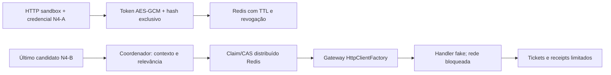

# Radar de Espera — N5-A

Base `d4c9c47abb08e0fb83836bdeb7bde4a24b0a4937`, branch `feat/radar-notificacoes`.
Commit de implementação: `8165b8b9c1a353f2a0af8241ad2fa3772dec2c93` (registrado por complemento documental, sem alterar o código validado).

## Estado da entrega e bloqueios

Preparados cadastro de tokens Android, gateway Expo via `HttpClientFactory`, coordenador de decisões N4-B e estado Redis limitado para claims, deduplicação e receipts. **Nenhuma notificação externa foi enviada. Nenhum frontend, GPS, ETA, SignalR, schema, migration, Docker/deploy, SSH, ngrok ou produção foi alterado/acessado.** Não existe worker push nem endpoint de envio. O worker N4-B não foi habilitado.

Produção permanece bloqueada por controles independentes:

- `Radar:PushEnabled=false` por padrão.
- Associação/coordenador requerem ambiente exatamente `Testing` e `Radar:Push:ControlledTestsEnabled=true`.
- HTTP exige ainda endereço loopback e `X-NoPonto-Push-Test`, capacidade aleatória efêmera acessível somente ao harness em processo, nunca retornada por endpoint/log/arquivo. Não é a credencial da instalação; ambas são exigidas nas operações HTTP protegidas.
- O client HTTP nomeado usa **`ExpoExternalTransportBlocked`**, handler que não abre conexão de rede. Nenhuma configuração remove esse bloqueio. Somente os testes substituem o handler por um fake.
- `pushDisponivel=false` da N4-A permanece inalterado. Cadastro em sandbox não confirma posse nem autoriza ativação pública.

Essas restrições são intencionais: informar um ExpoPushToken não prova que o solicitante controla o dispositivo. Unicidade e autenticação da instalação evitam transferência de uma associação existente, mas não resolvem um primeiro cadastro de token roubado. O frontend atual não implementa prova de posse, portanto não há exposição pública segura nesta etapa.

## Redis 7 real

**Homologação real não realizada.** `docker version` falhou por ausência do pipe `dockerDesktopLinuxEngine`, tanto no início quanto na verificação final. A distribuição WSL única `docker-desktop` estava parada. Não foi iniciado Docker Desktop nem qualquer container/banco preexistente. A API completa não foi iniciada, evitando bootstrap/migrations.

Os testes isolados reutilizaram o helper N4-A com **processos novos e descartáveis em loopback**, fakeredis 2.40.0/lupa 2.8 e StackExchange.Redis. Isso não comprova compatibilidade real Redis 7, replicação, failover ou atomicidade do servidor verdadeiro. Antes de remover qualquer bloqueio, criar Redis 7 exclusivamente para os testes e repetir a seleção abaixo **sem** `NOPONTO_RADAR_TEST_EMULATED`; nunca apontar ao Redis Debian ou a bancos compartilhados. Dados/volumes de terceiros não foram usados.

## Arquitetura



`RadarPushTokens` reutiliza `IRadarStore` e a autenticação Lua N4-A. Os comandos `push-put`/`push-delete` e a revogação fazem associação, exclusividade e limpeza atomicamente. O token é protegido por AES-GCM com nonce aleatório e chave de 256 bits só em RAM; não há keyring/arquivo de segredo. Redis guarda cifra, SHA-256 e revisão, nunca o token legível. Chave é descartada/zerada ao encerrar o provider; após reinício o token deve ser recadastrado. **Compartilhamento durável de chaves entre instâncias não está resolvido para produção.**

O mesmo token renova a associação por até 24h sem reiniciar revisão, claims, deduplicação ou receipts. Token diferente incrementa revisão e invalida estado pendente do destinatário antigo. Outro proprietário válido da mesma string provoca 409. Esta exclusividade não valida projeto Expo, autorização de notificações nem posse física.

Revogar instalação remove token, índice reverso, estado e até 32 referências pendentes daquele proprietário dentro da mesma operação Lua. TTL da associação nunca ultrapassa a credencial. Expiração física ou leitura de instalação vencida também impede uso. Não é criada tabela PostgreSQL.

## Contratos HTTP

| Método/rota | Resultado | Autorização |
|---|---|---|
| PUT `/radar/instalacao/push-token` | 200 com metadados | sandbox, capacidade de teste e Bearer N4-A |
| DELETE `/radar/instalacao/push-token` | 204, idempotente | mesmas verificações |

Não há GET de token, transferência por installationId, endpoint de disparo ou listagem de instalações alheias. Corpo limitado a 1 KiB; um token por instalação. Aceitos prefixos `ExpoPushToken[...]` e `ExponentPushToken[...]`, com conteúdo ASCII alfanumérico/`_`/`-` de 1–160 caracteres e limite total 200. É validação sintática conservadora, não confirmação de emissão pelo Expo. `platform` deve ser `android`; espaços, controles e sufixos extras são rejeitados. Rate limiting HTTP/instalação da N4-A continua aplicado.

```http
PUT /radar/instalacao/push-token
Authorization: Bearer <CREDENCIAL_DE_INSTALACAO>
X-NoPonto-Push-Test: <CAPACIDADE_EM_MEMORIA_DO_HARNESS>
Content-Type: application/json

{"expoPushToken":"ExpoPushToken[SYNTHETIC_NOT_FOR_DELIVERY]","platform":"android"}
```

```json
{"registered":true,"revision":1,"mode":"controlled_test_only","possessionConfirmed":false}
```

Respostas nunca incluem token, cifra ou fingerprint. `Cache-Control: no-store`. Fora do sandbox/capacidade: 404 antes de binding; credencial ausente/forjada/revogada: 401; entrada inválida: 400; token associado a outra instalação válida: 409; limite: 429; Redis indisponível: 503 sanitizado. Instalação conhecida sem segredo não autentica. Exemplo adicional em `NoPonto/radar-push.http`, sem credenciais reais.

## Payload e Android

Os campos `channelId`, `tag`, `collapseId`, `ttl`, `expiration`, `priority` e `data` foram conferidos na [documentação oficial de mensagens Expo](https://docs.expo.dev/push-notifications/sending-notifications/#message-request-format) e nos [tipos oficiais do SDK de servidor](https://github.com/expo/expo-server-sdk-node/blob/main/src/ExpoClient.ts).

| Campo | Valor preparado |
|---|---|
| `channelId` | `radar-espera-updates-v1` |
| `tag` | `noponto-radar-espera`, substitui a apresentação Android |
| `collapseId` | `noponto-radar-espera`, uma identidade de mensagens em trânsito |
| `priority` | `normal`, inclusive para linhas prioritárias |
| `ttl` | até 30s, limitado pela validade e recalculado a cada retry |
| `expiration` | prazo absoluto UTC da decisão |
| `data` | modo remoto, sessão, revisão, parada, hash de contexto e validade; sem credenciais/token |

Título/corpo são limitados e sanitizados; payload JSON tem teto conservador de 3500 bytes. Até três itens chegam na ordem N4-B, com indicação de prioridade de linha e sem seleção alternativa. Corpo usa “chegada prevista”/“saída prevista” e horários UTC explícitos. Não há áudio nem política de urgência. Para silêncio Android, N5-B deverá criar o canal com importância baixa, sem som/vibração; omitir `sound` sozinho não configura o canal. Nenhum canal foi criado no frontend nesta etapa.

## Coordenador e idempotência

`RadarPushCoordinator.ProcessarAsync(candidato)` é interno. Recarrega candidato, instalação, sessão e token; compara identidade/revisão/parada/instante da consulta; revalida contexto estrutural por escopo e rejeita previsão vencida. Cache estrutural é limitado a 200 vínculos e até 1s, com serialização de acesso ao DbContext. Não recalcula ETA. Publicações estruturais e Redis não formam transação distribuída; essa corrida residual permanece bloqueio de homologação do fluxo real.

Relevância inclui entrada/saída de itens na janela, evento/veículo novo, tipo, prioridade, fonte/qualidade, troca de sessão/contexto/revisão, mudança de previsão >=60s e cruzamentos de 5/2/1min. Contagem regressiva comum não notifica a cada ciclo. Conteúdo vazio após itens anteriores pode produzir substituição textual “sem chegadas”; vazio inicial não envia.

Lua compara o snapshot atual e a referência anterior antes de reservar um claim por instalação. Grava o conteúdo **tentado antes do HTTP**, impedindo que outro processo repita a decisão. Imediatamente antes de cada tentativa, confere novamente instalação, sessão, revisão, candidato, token e prazo do claim; cobra orçamento global. Reconfiguração, substituição de token ou revogação impedem retries antigos. Claims têm janela de 10s; deduplicação persiste até expiração da sessão +60s, máximo 61min. Não há fila de candidatos antigos.

Não existe exactly-once externo: uma conexão pode cair após aceitação. POST ambíguo não é repetido automaticamente e a mesma decisão fica suprimida; isso pode perder uma atualização. Respostas explícitas transitórias usam até três tentativas, com backoff de 250/500ms, respeitando Retry-After e a validade. Retries podem ser agrupados/substituídos pelo identificador Android, mas não comprovam entrega. O [Expo descreve sua entrega como best effort e potencialmente repetida](https://docs.expo.dev/push-notifications/faq/). Uma requisição já aceita pelo provedor não pode ser desfeita por revogação posterior; o receiver futuro precisará rejeitar revisões/prazos obsoletos.

## Tickets, receipts, falhas e limites

Ticket `ok` vira estado `ticket`, nunca “entregue”. Receipts são consultados pela interface interna `ConsultarReceiptsAsync`; não existe polling push ativo nesta etapa. O fluxo agenda consulta após 15min e conserva metadados por até 24h, conforme a [orientação Expo para receipts](https://docs.expo.dev/push-notifications/sending-notifications/#check-push-receipts-for-errors). Receipt `ok` é handoff ao provedor, não confirmação do aparelho, como esclarece o [FAQ Expo](https://docs.expo.dev/push-notifications/faq/).

`DeviceNotRegistered` remove associação somente quando fingerprint e revisão ainda correspondem. Receipt tardio não apaga token substituído. Falha de credenciais pausa claims globalmente por 1h e exige revisão manual; mensagens/erros brutos do provedor nunca são expostos/logados. HTTP 429/5xx têm retry limitado; HTTP permanente não. Receipts podem repetir consultas seguras em falhas transitórias, sob orçamento reservado.

Defaults, sem configuração operacional aplicada:

```json
{
  "Radar": {
    "PushEnabled": false,
    "Push": {
      "ControlledTestsEnabled": false,
      "MaxRequestsPerMinute": 60,
      "MaxPendingReceipts": 256,
      "MaxAttempts": 3,
      "MaxConcurrency": 2,
      "MinIntervalSeconds": 30
    }
  }
}
```

Orçamento de requisições é distribuído no Redis. Conexões são limitadas a duas por processo, sem fila quando ocupadas; capacidade global de pendências e mínimo de 30s por sessão/revisão fornecem backpressure. Cada proprietário pode ter no máximo 32 pendências. Saturação pode descartar/adicionar atraso a atualizações; 256 receipts aguardando 15min limitam o fluxo sustentado abaixo do teto nominal de requisições. Não são números de capacidade do Debian, nem benchmark.

Novas chaves sob `noponto:radar:v1:{radar}:`:

| Sufixo | Conteúdo / limite |
|---|---|
| `push:token:{ownerN}` | cifra/fingerprint/revisão; até 24h e limitado pela credencial |
| `push:owner:{fingerprint}` | proprietário exclusivo da string; mesmo TTL |
| `push:state:{ownerN}` | claim e último conteúdo tentado; até 61min |
| `push:pending` | índice global de reservas/receipts; até 256 por padrão |
| `push:pending-owner:{ownerN}` | até 32 referências; TTL 24h |
| `push:receipt:c:{claim}` | reserva de capacidade; TTL 120s |
| `push:receipt:r:{ticket}` | proprietário/fingerprint/revisão, sem token; TTL 24h |
| `push:rate`, `push:receipt-lease`, `push:halt` | contador 120s, lease de consulta 30s e pausa de credenciais 1h |

Limpeza é por índices limitados, sem SCAN. Contadores em `RadarPushMetrics.Snapshot()` são agregados: tentativas, retries, tickets, receipts e erros. Não há rótulos por usuário/dispositivo, logs de payloads ou histórico ilimitado. Loggers padrão do client HTTP foram removidos. O estado não promete entrega durável nem recuperação de POST ambíguo.

## Notificação já exibida e duplicação local/push

TTL/collapse não retiram automaticamente uma notificação já na bandeja. O corpo contém horário/validade para evitar aparência de previsão permanente; isso **não resolve sozinho** encerramento/expiração. Backend não pode cancelar com garantia uma notificação Android já exibida usando os campos Expo disponíveis.

Estratégia nativa a homologar na N5-B: receiver/renderer Android controlado por módulo/config-plugin, sem depender de JS em segundo plano, que confira `sessionId/revision/validUntil` antes de apresentar, preserve tag/ID e aplique timeout nativo. Android oferece [`Notification.Builder.setTimeoutAfter`](https://developer.android.com/reference/android/app/Notification.Builder#setTimeoutAfter(long)) para cancelamento pelo sistema após o prazo (API 26+). O módulo deverá integrar-se ao caminho nativo que realmente posta a notificação; adicionar um campo Expo não suportado não resolve. Não implementado nem comprovado em aparelho. Forçar parada, ausência de rede e restrições do sistema continuam limitações de entrega.

Na integração, um único modo deve ser autoritativo: ao ativar remoto confirmado, cancelar a notificação local existente e suspender o publisher local para essa sessão. Ao retornar ao app, reconciliar com backend, remover apresentações vencidas e não disparar ambos os transportes. Receipts não podem orientar essa exclusão como prova de recebimento. Normal priority com TTL curto pode perder mensagens durante Doze; não se aumentou prioridade para mascarar essa limitação. Com deduplicação e expiração curta, a apresentação pode desaparecer antes de outra mudança relevante; N5-B deverá definir essa experiência sem prometer acompanhamento visual contínuo ou reutilizar previsão vencida.

## Testes

Build Release `--no-incremental`: **exit 0, zero erros e seis avisos preexistentes** (duas declarações CS8981 em migrations existentes, CS7022 do test SDK e três xUnit2031 em testes existentes).

Rodada final com Redis **emulado** e HTTP Expo fake: **Passed: 181, Failed: 0, Skipped: 0**. TRX conferido sem abortos, timeouts ou inconclusivos: 49 casos N4-A, 65 N4-B, 55 N5-A e 12 projeções de eventos existentes. Evidência local: `artifacts/n5a/n5a-final.trx`.

Rodada sem opt-in Redis: **Passed: 148, Failed: 0, Skipped: 33**, em `artifacts/n5a/n5a-offline.trx`. Os 33 ignorados correspondem às integrações Redis explicitamente bloqueadas na ausência de instância descartável. Rodadas sobrepostas sobre os mesmos 181 casos, não somar como casos distintos.

Durante desenvolvimento, uma contagem condicional no fake de contexto impediu o teste de simular a mutação no momento correto; o fake foi corrigido preservando as asserções. Outro caso revelou que `InvalidDataException` precisava de tratamento explícito para resposta HTTP excessiva; o gateway foi corrigido e mantém o resultado sanitizado `unknown`, sem retry de POST ambíguo. A revisão acrescentou cadastro idempotente do mesmo token para preservar claims/receipts, com caso Redis dedicado. Todos esses ajustes constam na rodada final. Nenhum teste N4-A/N4-B foi alterado para esconder incompatibilidade.

Não executados Redis real, PostgreSQL real, API completa, FCM/EAS real, Android, testes de bandeja/Doze, falhas de rede reais, failover/Cluster ou benchmark produtivo. Nenhum envio externo, segredo real ou arquivo de segredo foi usado/criado. Emuladores próprios encerrados após testes; artefatos anteriores e TRXs locais preservados fora dos commits.

Comandos finais (emulador próprio, nunca produção):

```powershell
dotnet build NoPonto/NoPonto.csproj -c Release --no-incremental -v:q
$env:NOPONTO_RADAR_TEST_REDIS = '127.0.0.1:6421,abortConnect=true,connectTimeout=3000,syncTimeout=5000'
$env:NOPONTO_RADAR_TEST_EMULATED = '1'
dotnet test NoPonto/NoPonto.csproj -c Release --no-build --filter 'FullyQualifiedName~NoPonto.Tests.Radar|FullyQualifiedName~NoPonto.Tests.EventosParadaProjectionTests' --logger 'trx;LogFileName=n5a-final.trx' --results-directory artifacts/n5a -v:q
```

HTTP usa Kestrel efêmero separado, com store sintético e sem `Program.cs`/bootstrap/SQL. Expo usa `HttpMessageHandler` falso. Testes Redis têm opt-in explícito, loopback, coleção serial e limpeza de IDs/chaves criados na instância descartável. Nenhum teste envia push real.

| Requirement | Evidence |
|---|---|
| Cadastro/substituição/remoção | `RegistroSubstituicaoRemocaoCriptografadosEExclusividadeDoToken`, `CadastroRepetidoMesmoTokenPreservaClaimEReceipts` |
| Credencial e exposição controlada | `CredencialForjadaEIdIsoladoNaoAssociamToken`, `HttpPushNaoExpostoPublicamente`, `HttpTokenExigeCredencialValidaValidaEntradaENaoRetornaToken` |
| Revogação | `RevogacaoRemoveTokenEstadoIndiceEPendencias` |
| Formato/criptografia | `TokenInvalidoRejeitadoAntesDoRedis`, `TokenProtegidoNaoRevelaTextoEChaveEfemeraDiferenteNaoAbre` |
| Payload/tag/collapse/silêncio | `PayloadCompactoSilenciosoTagCollapseEstaveisESemSegredosEmData` |
| Deduplicação/relevância | `CoordenadorDeduplicaSemEnviarACadaCiclo`, `RelevanciaDistingueMudancasDeContagemRegressiva` |
| Expiração/reconfiguração | `ExpiracaoEReconfiguracaoAntesDaTentativaImpedemHttp`, `RevisaoAlteradaDuranteBackoffImpedeRetry` |
| DeviceNotRegistered | `DeviceNotRegisteredNoTicketRemoveTokenECredenciaisBloqueiamNovosClaims`, `ReceiptsSaoConsultadosEDeviceNotRegisteredNaoApagaTokenSubstituido` |
| Tickets/receipts | `TicketsEReceiptsNaoSignificamEntregaAoAparelho`, `ReceiptsLimitadosERetryDeConsultaSeguro` |
| Limites/retries | `VolumeGlobalRedisEIntervaloMinimoLimitamTentativas`, `RateLimitFazBackoffLimitadoEReduzTtlDaTentativa`, `ConcorrenciaDoGatewayTemBackpressureSemFila` |
| Indisponibilidade/ambiguidade | `IndisponibilidadeExpoTemTetoDeRetriesESemFilaAntiga`, `FalhaAmbiguaDeRedeNaoRepetePost`, `CancelamentoAposClaimMantemAceitacaoAmbiguaSemRetry` |
| Redis indisponível | `FalhaRedisPushNaoEnviaENaoExpoeConexao` |
| Duas instâncias/capacidade | `DuasInstanciasConcorrentesEnviamSomenteUmaVez`, `ClaimsDistribuidosNaoSeSobrepoemEMaximoPendenteAplicaBackpressure` |
| Flags/rede bloqueada | `FlagsDesabilitadasNaoLeemRedisNemChamamExpo`, `TransporteRegistradoNaoAcessaRedeMesmoComFlagsEmTesting` |

## Intervenções manuais e N5-B

1. Homologar Redis 7 real descartável, sem modo emulado; repetir os testes distribuídos e validar recursos/Cluster caso aplicável. Não remover a trava de rede antes dos demais bloqueios.
2. Definir e implementar confirmação de posse: nonce de uso único com TTL, vinculado a instalação/token/projeto, recebido no dispositivo e confirmado usando sua própria credencial e enrollment iniciado localmente. Não expor nonce em consulta; rejeitar challenges não solicitados/replays. A confirmação requer frontend/native e testes controlados novos, ausentes nesta etapa.
3. Definir armazenamento compartilhado protegido/rotação das chaves de cifra para várias instâncias. AES efêmero atual é apenas sandbox; testes concorrentes usam dois clientes Redis e uma chave sintética compartilhada em processo, não homologam keyring distribuído.
4. No projeto de desenvolvimento autorizado: vincular `applicationId`/Firebase e `projectId` Expo, instalar/configurar `expo-notifications`, solicitar permissão Android, gerar token e criar canal silencioso. Usar development build, não pressupor suporte push do Expo Go. Seguir o [setup oficial Expo](https://docs.expo.dev/push-notifications/push-notifications-setup/).
5. Operador deve configurar FCM V1 no projeto próprio e carregar a service-account key no EAS/Expo, além de configurar `google-services.json`/app build. O backend Expo não recebe chave FCM. Seguir [credenciais Android oficiais](https://docs.expo.dev/push-notifications/fcm-credentials/); nenhum arquivo/chave foi criado ou consultado aqui.
6. Habilitar enhanced push security no Expo e fornecer acesso ao gateway por provider de segredo gerenciado, sem Git/log/arquivo criado por esta tarefa. Hoje `ExpoNoAccessToken` não lê credencial alguma. O [Expo documenta Bearer adicional](https://docs.expo.dev/push-notifications/sending-notifications/#additional-security); apenas um valor sintético foi testado.
7. Implementar timeout/reconciliação nativos, resolver a lacuna de presença terminal da N4-B e coordenar modo local/remoto. Validar cold start, Doze, app encerrado, revogação/reconfiguração em voo e bandeja expirada em NoPonto Dev, com autorização específica para envios reais.
8. Só então substituir explicitamente o handler bloqueado por transporte HTTPS, criar dispatcher/consulta de receipts limitados e habilitar flags em ambiente autorizado. Isso não foi executado nesta N5-A; nenhum teste prova entrega física, produção ou exactly-once.

## Arquivos

Novos: `RadarPushContratos.cs`, `RadarPushTokens.cs`, `ExpoPushGateway.cs`, `RadarPushCoordinator.cs`, `RadarPushRedisStore.cs`, `RadarPushController.cs`, `RadarPushTests.cs`, `RadarPushRedisTests.cs`, `NoPonto/radar-push.http` e este documento. Modificados: `RadarRegistration.cs` (DI), `RadarService.cs` (somente flag), `RadarRedisStore.cs` (comandos de token e limpeza na revogação), `NoPonto/HISTORICO.md`. Serviços GPS/ETA/SignalR, projetos/pacotes e frontend permanecem intactos.
