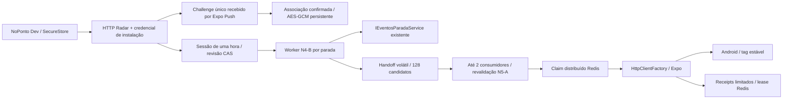

# Radar Android — N5-B

Base backend `dec65e1`, frontend `3c035ac`, branches `feat/radar-notificacoes`. Checkpoint N5-C0 da implementação N5-B, com evidência automatizada anterior e validação real confirmada pelo operador. Flags produtivas continuam desabilitadas por padrão; o laboratório não comprova implantação da API completa.

## Arquitetura integrada



O motor conserva uma consulta de eventos por parada e as regras N4-B de ETA, prioridade, alternativa e veículos distintos. O enfileiramento não aguarda HTTP externo dentro do timeout da consulta. Fila em memória de 128 candidatos, `DropOldest`, sem histórico ou promessa de entrega durável; ao reiniciar, novos ciclos recompõem somente conteúdo atual. Consumidores compartilham o cache estrutural N5-A por escopos de até 20 decisões e usam a revalidação Lua imediatamente antes de cada tentativa. Nenhuma notificação é enviada por polling do frontend.

Fila, consumidores e receipts exigem `Radar:Enabled`, `Radar:WorkerEnabled`, `Radar:PushEnabled` e política experimental. O gateway também exige configuração explícita de transporte. Ativar push não ativa automaticamente o worker. Instalações fora da allowlist não entram na fila. Claims, intervalo mínimo, orçamento global e limite de receipts continuam distribuídos no Redis; filas locais de várias instâncias não removem a deduplicação N5-A.

## Registro e confirmação

As rotas N4-A de instalação e sessão permanecem compatíveis. O PUT de token sem prova da N5-A permanece exclusivamente no sandbox Testing; não é o caminho Android experimental. Tokens não confirmados no sandbox são recusados pelo store de envio quando `ExperimentalEnabled=true`.

| Método/rota | Resultado |
|---|---|
| POST `/radar/instalacao/push/confirmacoes` | 202, `{ "state":"pending", "expiresInSeconds":120 }` |
| POST `/radar/instalacao/push/confirmar` | 200, `{ "registered":true, "revision":1, "mode":"experimental", "possessionConfirmed":true }` |
| GET `/radar/instalacao/push` | 200, `{ "registered":true, "possessionConfirmed":true, "revision":1 }` |
| DELETE `/radar/instalacao/push` | 204, idempotente |

Todas exigem Bearer N4-A. Corpo máximo 1 KiB, `no-store`, limites HTTP/Redis existentes. Identificador conhecido sem credencial não autentica. Apenas metadados são consultáveis; não há endpoint de disparo, nonce por GET ou enumeração de instalações.

O Android gera e persiste `enrollmentId` aleatório antes do POST:

```json
{
  "enrollmentId": "aaaaaaaa-aaaa-4aaa-8aaa-aaaaaaaaaaaa",
  "projectId": "ab3db7e8-2478-49d6-a339-e639dcce1a34",
  "expoPushToken": "ExpoPushToken[SYNTHETIC_NOT_FOR_DELIVERY]"
}
```

O servidor gera prova criptográfica de 256 bits, guarda somente SHA-256 da prova e token cifrado, e envia a prova no `data` de um push genérico. O aplicativo aceita somente o enrollment iniciado localmente, para o mesmo projeto, dentro de 120s; confirma com sua própria credencial. Outra instalação não consegue consumir a prova. Lua consome o challenge uma única vez, limita cinco provas erradas e só então associa/substitui o token atomicamente. Cadastro anterior continua válido até a nova prova. Há uma iniciação por minuto por instalação; todas as tentativas compartilham o orçamento global do push.

Erros: 400 formato/projeto; 401 credencial inválida; 403 instalação não autorizada; 404 flags; 409 prova inválida/vencida/reutilizada ou token pertencente a outro proprietário válido; 429 cotas; 503 Redis/provedor indisponível. Um token formatado corretamente não é prova de posse. A allowlist e a confirmação precisam permanecer juntas no experimento; a lista tem teto de 100 IDs.

O challenge reserva capacidade antes de enviar e pode produzir receipt com revisão especial `-1`, que nunca remove uma associação confirmada mais recente. Ticket não comprova entrega; a confirmação válida do challenge prova que aquele conteúdo foi recebido por esse fluxo no aparelho autenticado, sem generalizar para notificações futuras.

## Configuração e segredo persistente

```json
{
  "Radar": {
    "Enabled": false,
    "WorkerEnabled": false,
    "PushEnabled": false,
    "Push": {
      "ExperimentalEnabled": false,
      "ExternalTransportEnabled": false,
      "ProjectId": "ab3db7e8-2478-49d6-a339-e639dcce1a34",
      "AllowedInstallationIds": [],
      "EncryptionKeyFile": "/caminho-protegido-fora-do-git/push-encryption.key",
      "ExpoAccessTokenFile": "",
      "MaxRequestsPerMinute": 60,
      "MaxPendingReceipts": 256,
      "MaxAttempts": 3,
      "MaxConcurrency": 2,
      "MinIntervalSeconds": 30
    }
  }
}
```

AES-GCM usa a mesma chave de 32 bytes em arquivo protegido entre reinícios e instâncias. `tools/radar/new-experimental-key.ps1` gera a chave fora do repositório, em diretório com ACL apenas usuário/SYSTEM, e recusa sobrescrita. No Debian usar diretório 0700/arquivo 0600 do usuário da API, montado somente leitura; distribuir a mesma chave por canal protegido, nunca Git. O script foi executado localmente e a ACL conferida, sem exibir o valor. Não há configuração de produção alterada. Trocar/perder a chave exige reenrollment; não existe rotação sobreposta de keyring nesta entrega.

`ExpoAccessTokenFile` é opcional para enhanced push security do projeto Expo. O backend não recebe chave privada FCM. Arquivo de acesso Expo, se necessário, também fica fora do Git com permissões restritas. O transporte permite somente o endpoint HTTPS Expo fixo, não segue redirects, mantém limites N5-A e remove loggers do HttpClient.

Novas referências Redis: `push:challenge:{ownerN}`, hash TTL120s, e `nextChallenge` no hash de instalação. Reservas e receipts usam os índices limitados N5-A; nenhuma varredura global, migration ou tabela nova. Token cifrado confirmado recebe `confirmed=1`. Revogação/remoção apagam challenge, token e pendências do proprietário atomicamente.

## Laboratório isolado

`tools/radar/NoPonto.Radar.DevHost` referencia a implementação existente sem executar o `Program.cs` da API, migrations ou hosted services GPS/ETA/SignalR. Escuta exclusivamente `127.0.0.1:8083`; expõe somente controllers Radar N4-A e enrollment experimental. Configuração obrigatória por `NOPONTO_RADAR_DEV_CONFIG`, JSON protegido externo, sem carregar `.env` automaticamente.

`EnrollmentOnly` permite começar pelo challenge sem SQL e recusa worker/contextos. `LiveReadOnly` reutiliza `EventosParadaService`, `EstruturaLeituraV2Repository`, `VeiculosLinhaRuntimeReader` e `RoadEtaDistances`; PostgreSQL usa `default_transaction_read_only=on`, pool4 e timeout5s. O cache runtime só implementa HGET do formato RedisCache; Set/Remove/Refresh falham, inclusive para impedir renovação acidental de sliding TTL produtivo. Redis Radar é separado e obrigatoriamente loopback, inclusive quando acessível por túnel.

O laboratório LiveReadOnly é rodoviário: presença/publicação ferroviária não é fabricada, e contextos ferroviários falham fechados. Reutiliza o ETA físico existente; não possui o histórico EMA em memória do processo GPS produtivo. Não declarar equivalência da EMA do laboratório com o processo publicado. A integração normal da API mantém suas dependências e ETA híbrido existentes, sem alterar esses serviços.

## Android e reconciliação

SDK Expo55 mantido. `expo-notifications ~55.0.27` já existia; adicionados somente `expo-secure-store ~55.0.18` e `expo-crypto ~55.0.19`. Lock preserva todas as resoluções anteriores; a diferença semântica contém apenas os dois pacotes novos. O check Expo aponta recomendações de atualização preexistentes em outros módulos; não foi feita atualização geral do SDK.

Aplicativo Dev `com.guilhermedesales.nononto.dev`, projeto Expo original preservado. Canal `radar-espera-updates-v1`: LOW, sem som/vibração/badge. Credencial, enrollment pendente e cache do token ficam no SecureStore Android, não em AsyncStorage. Recuperação consulta instalação/sessão autenticadas, trata 401/403/422/429/conexão, reobtém token e exige nova prova quando necessário. Consultas não renovam a hora da sessão. Após expiração, a tela informa e exige ativação intencional. Prazos/revisões continuam autoritativos no backend.

`EXPO_PUBLIC_RADAR_REMOTE_ENABLED=true` é opt-in do build/runtime Dev. `EXPO_PUBLIC_RADAR_API_BASE_URL` é separado da API de mapa e não tem fallback produtivo. HTTPS é exigido; exceção de desenvolvimento somente para localhost/127.0.0.1 via ADB reverse. No modo remoto, o publisher local fica suspenso também quando pendente/indisponível, evitando fallback automático duplicado. Receipts não são usados como confirmação física para essa arbitragem.

Tag/collapse continuam `noponto-radar-espera`. Handler em primeiro plano aceita somente sessão/revisão e prazo atuais; reconciliação remove apresentações antigas. **TTL do Expo não remove notificações já exibidas.** Sem validação nativa de recepção em segundo plano, mensagens aceitas antes de encerramento podem reaparecer dentro do TTL e permanecer na bandeja. Não foi adicionado módulo nativo complexo antes de verificar comportamento real do Expo. `Notification.Builder.setTimeoutAfter` é uma alternativa nativa a avaliar no caminho que efetivamente apresenta a mensagem, não um campo Expo inventado. Doze, fabricante, ausência de rede e force-stop impedem garantias de entrega; encerramento normal e force-stop devem ser reportados separadamente.

## Evidências anteriores ao checkpoint

- Redis7 real descartável local: 7.4.8, `127.0.0.1:6422`, nome exclusivo/label `noponto.task=radar-n5b`, memória128MiB/1CPU, sem persistência. Não foram usados dados/containers Redis preexistentes. Primeira rodada: 181 aprovados/0falhas/0ignorados, sem `NOPONTO_RADAR_TEST_EMULATED`. Rodada final: **197 executados/aprovados, zero falhas**, conforme contadores do TRX local `artifacts/n5b/n5b-redis7-final.trx`, conferidos na auditoria. Artefato permanece fora do Git; testes não repetidos no checkpoint.
- Novos testes de enrollment/fila/worker: 16 aprovados no Redis real e HTTP fake. Contratos HTTP executados em Kestrel efêmero, sem bootstrap completo.
- Host de laboratório compilado e iniciado; cadastro/consulta autenticada/revogação exercitados, rota alheia `/health`=404. Fonte PostgreSQL conferida com `transaction_read_only=on`; nenhuma mutação.
- FCM V1 inicialmente ausente, configurado pelo operador para o Dev/Firebase `noponto-2d820` e confirmado por consulta de metadados sem ler chave privada. Arquivo cliente fornecido fora dos repositórios, validado por package/projeto e usado no prebuild. Variável EAS de arquivo `NOPONTO_DEV_GOOGLE_SERVICES_FILE`, visibilidade secret, criada somente em development.
- Primeira solicitação EAS `0c1d8cb6-2486-4998-94d6-0d4d08442234` cancelada ainda na fila quando faltava FCM; nenhum APK dela. O teste real posterior comprova o uso de aplicativo instalado; este checkpoint não atribui hash, origem ou resultado a um APK sem evidência documental suficiente.
- Operador mantém Metro/reverses 8083/8084 e laboratório em execução. Nenhum serviço foi iniciado, interrompido ou reconfigurado no checkpoint.

## Validação real confirmada e limites — N5-C0

O operador confirmou no Redmi Note 11: instalação autorizada na allowlist, enrollment concluído, sessão ativada por uma hora e recebimento de Expo Push com o aplicativo em segundo plano, inclusive previsões reais das linhas 838 e 884. O fluxo usa DevHost em loopback, Redis isolado e PostgreSQL via túnel somente leitura. É evidência de recebimento no aparelho nesse cenário; não é homologação da API Docker produtiva, de entrega garantida ou de latência.

Problemas observados e ainda **não corrigidos**: notificações acumuladas em vez de substituídas; comportamento ao tocar/abrir uma notificação; conteúdo repetitivo; mensagem de ausência de chegadas seguida de ETA. Tag/collapse estão no payload, mas não garantiram substituição observada. A causa exata do acúmulo não foi comprovada. O texto de ausência também pode representar filtragem de evidências, não ausência física de veículos. TTL não recolhe conteúdo já exibido; não existe renderer nativo de validade/revisão neste checkpoint.

Sem evidência suficiente para declarar aprovados: tela bloqueada como cenário separado, encerramento normal/force-stop, Doze, substituição única, remoção automática após expiração, reinício da API completa, receipts reais, falha/recuperação ponta a ponta e consumo no servidor de 4GB. Não há medição consolidada de latência de envio/recebimento. Cenários automatizados não substituem essa validação física.

O cliente mantém bloqueio explícito para `com.guilhermedesales.nononto.dev`, URL Radar separada e HTTPS obrigatório fora da exceção local de desenvolvimento. Timeout usa `AbortController` + `setTimeout`/`clearTimeout`, compatível com React Native/Hermes, sem exigir `AbortSignal.timeout`. Sair do pacote Dev exige configuração Android/FCM/EAS e revisão deliberada desse bloqueio; não basta trocar a URL.

N5-C0 apenas consolida o WIP e documentação: nenhum código funcional alterado, teste/build repetido, segredo versionado ou preparação de deploy iniciada. DevHost, ponte loopback e gerador de chave são fontes auxiliares opcionais, não componentes da imagem produtiva. Configurações privadas, chaves, logs e artefatos permanecem fora do commit.

## Validação manual restante

Enrollment, ativação e recebimento em segundo plano já foram confirmados; não são pendências de implementação. Restam validar substituição e validade da apresentação, abertura pelo toque, tela bloqueada, encerramento normal, reconfiguração, encerramento, expiração, reinício, falha/recuperação e Doze, registrando evidência por cenário. Não usar force-stop como equivalente a retirar dos recentes. Medir envio/recebimento somente com timestamps observados; não extrapolar medições sintéticas para produção. Estes passos não foram executados no N5-C0.

## Referências

- [Expo: campos, tag/collapse e receipts](https://docs.expo.dev/push-notifications/sending-notifications/)
- [Expo: FCM V1 e arquivo Android](https://docs.expo.dev/push-notifications/fcm-credentials/)
- [Expo: notificações e development builds](https://docs.expo.dev/versions/latest/sdk/notifications/)
- [Android: timeout de notificação](https://developer.android.com/reference/android/app/Notification.Builder#setTimeoutAfter(long))
